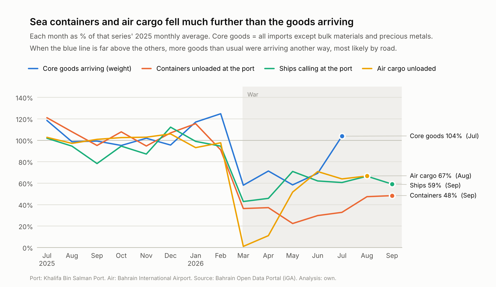

# Shock and Recovery: Bahrain's import supply chains in 2026

**Question:** how far did Bahrain's imports fall below normal during the 2026 Gulf crisis, which supply chains were hit hardest, and how far have they come back?

**Approach:** train forecasting models on imports up to December 2025, forecast 2026 as if nothing had happened, and compare with what actually arrived. The same "pretend it's January" test is run on 2024 and 2025 to measure normal forecasting error, so a 2026 gap can be judged against it. Port and airport totals are used to check which routes broke.

**Status:** Step 5 of 7 done (2026 shortfall measured). Next: routes and recovery.

| Step | What | Status |
|---|---|---|
| 1 | Download and check the data | done |
| 2 | Clean and organise | done |
| 3 | Explore | done |
| 4 | Forecasting models, tested on 2024 and 2025 | done |
| 5 | Measure the 2026 shortfall | done |
| 6 | Routes and recovery | next |
| 7 | Write up and publish | |

Extras after step 7, if there is time: a "what if" range for how much came by road, and whether products that relied on only a few supplier countries were hit harder.

## Data

All data comes from the [Bahrain Open Data Portal](https://www.data.gov.bh) (Information & eGovernment Authority).

| File | What it holds | Coverage |
|---|---|---|
| `imports_2021.csv` ... `imports_2026.csv` | Non-oil imports by 8-digit product code, origin country and month: value (BD, USD), weight (kg), quantity | Jan 2021 to Jul 2026, about 1.76M rows |
| `port_containers.csv` | Monthly containers (TEUs) at Khalifa Bin Salman Port, by type | 2019 onwards |
| `port_vessels.csv` | Monthly ship visits at Khalifa Bin Salman Port, by type | 2019 onwards |
| `airport_cargo.csv` | Monthly air cargo (tonnes) at Bahrain International Airport | 2023 onwards |

`data/reference/events.csv` lists verified dates of the events used to label periods (COVID restrictions, the 2026 conflict, the Strait of Hormuz closure, airspace closure and reopening, causeway closures), each with a source link.

## Quick start

```bash
python -m venv .venv
source .venv/bin/activate          # Windows: .venv\Scripts\activate
pip install -r requirements.txt

python src/download_data.py        # step 1: about 0.4 GB; takes a few minutes
python src/check_downloads.py      # step 1: confirms every file is complete
python src/build_dataset.py        # step 2: cleans and builds the analysis tables (about 20 s)
python src/explore.py              # step 3: charts and findings in reports/ (about 10 s)
python src/backtest.py             # step 4: trains and tests the models (about 2 minutes)
python src/shortfall.py            # step 5: the 2026 shortfall (about 15 s; needs step 4 first)
pytest                             # tests
```

If a download fails, run `download_data.py` again: it skips files it already has.

`check_downloads.py` compares every month's import value and weight with figures measured on the portal on 2026-10-11. It should end with `All checks passed`. It will also print a few NOTES (for example, rows that share a product, country and month); those are expected and are handled in step 2. If the portal has published a new month since then, it says so.

## Step 2: cleaned tables

`build_dataset.py` writes these (details and checks in `reports/step2_cleaning_report.md`):

| File | One row per | Main columns |
|---|---|---|
| `data/processed/imports_clean.parquet` | month x 8-digit product x origin country (1.76M rows) | `date`, `hs8`/`hs6`/`hs4`/`hs2`, `section_name`, `product_group`, `commodity_en`, `iso2`, `country_en`, `value_bd`, `weight_kg`, `quantity`, `unit`, `n_shipments`, quality flags |
| `data/processed/route_monthly.parquet` | month | port containers by type (TEUs), ship visits by type, air cargo tonnes |
| `data/reference/calendar.csv` | month, 2019-2027 | `ramadan_days`, `eid_al_fitr`, `eid_al_adha`, `covid_restrictions`, `covid_closure_days` |
| `data/reference/hs_sections.csv` | HS chapter | section number and name |

Cleaning decisions, all based on profiling the real files:
- Separate shipments of the same product from the same country in the same month are added together (6 cases). Monthly totals are checked to be identical before and after.
- Odd rows (zero weight, zero or negative value, value per kg above 100,000 BD) are flagged, not dropped, so totals still match the official figures.
- **Bulk raw materials are labelled** in `product_group`: iron ore, alumina, coke and construction minerals are about 85% of import weight but under 22% of value. Weight-based analysis must separate them from general goods.
- **Models will work at 4-digit level or coarser.** The HS 2022 revision added 722 new 8-digit codes carrying 2.7% of 2022's value; at 4-digit level code changes affect at most 0.12% of value in any year.

## Step 3: what the data shows

`explore.py` writes six charts to `reports/figures/` and the findings to `reports/step3_exploration.md`. The main points (changes are against the 2025 monthly average):

- **Three kinds of imports behave differently and are analysed separately.** *Core goods* (73% of 2025 value) are the everyday supply chains. *Bulk materials* (iron ore, alumina, coke, construction minerals: 85% of weight) arrive in shiploads for a few factories. *Precious metals* follow the gold price.
- **Core goods** were 7% above normal in Jan-Feb 2026, 53% below in March, and 15% below by June-July.
- **Origins:** goods from GCC countries rose (their share went from 15% to 25%), while goods from East and South-East Asia were still 36% below normal in June-July.
- **Routes:** in June-July, containers unloaded at Khalifa Bin Salman Port were about 31% of normal and air cargo 67%, while core goods were back to 85%. Far more than usual must have come another way, most likely by road over the King Fahd Causeway (tested in step 6).
- **Normal patterns:** seasonality is weak and there is no clear Ramadan effect, so a simple "last year's monthly average" forecast beats "the same month last year".
- **Level of detail:** the more detailed the series, the bigger the normal forecast miss (6% for the national total, 31% for HS2 chapter x origin region, 68% for HS4 x country). Models will forecast at HS2 x origin region and add up to sections, regions and the national total.



## Step 4: the forecasting model

`backtest.py` builds a training table, tests four forecasts on 2024 and 2025 as if it were January of each year, and writes `reports/step4_models.md` (details, tables and four charts).

- **What is forecast:** core goods, as 663 series (one HS2 chapter from one origin region; patchy ones pooled), using clues known at the end of December: recent levels, trend, the same month in earlier years, calendar (Ramadan, Eid, December) and COVID flags.
- **The four forecasts:** last year's average month (the simple rule), the same month last year, a ridge regression written from scratch in NumPy (normal equations and gradient descent, which agree to about 1e-15), and gradient-boosted trees (scikit-learn).
- **Result:** the linear model wins in both test years at every level. In the 2025 final check, which wasn't used for any choices, its national miss was 5.5% against 6.2% for the simple rule. The trees didn't beat the simple rule: with four to five years of noisy monthly data their flexibility mostly fits noise. Trained on absolute error, they also undershot totals by about 5%, because they forecast medians.
- **Ranges:** the model's misses set a "9 months out of 10" range for every national, region and section total. Set on 2024 and checked on 2025, 88-92% of months fell inside.
- **Sanity check:** retrained on 2021-2025, the model's forecasts for January and February 2026, before the war, were within 2-4% of the actual national totals.


## Step 5: the 2026 shortfall

`shortfall.py` compares each month of 2026 with step 4's forecast of imports without the war and writes `reports/step5_shortfall.md` (five charts). A gap only counts as a real shortfall if it is outside the model's normal range, measured in step 4's tests; longer periods get narrower ranges.

- **Core goods were about BD 624 million (32%) below normal from March to July 2026**, likely between BD 539 and 710 million. The gap was -54% in March, -36% in April-May and -18% in June-July; by July (-9%) it was back inside a normal month's range.
- **Hardest-hit products:** vehicles and transport (-62%), footwear, wood, machinery and clothing (about -40% each). Machinery and vehicles account for 64% of the money lost. Only 4 of 18 sections stayed within their normal range.
- **Hardest-hit origins:** the Americas and East and South-East Asia (both -48%), which normally ship through the Strait of Hormuz. Goods from GCC countries held up (+8%, inside the normal range).
- **Second opinion:** the gradient-boosted trees give the same picture (national -33%; section and region gaps within 4 points).
- **Close-ups:** cars were still -51% in June-July, while rice and poultry bounced back above normal. Aircraft deliveries made March look about 9 points worse than everyday supply chains were.


## Layout

```
data/raw/          downloaded files, untouched (not committed; MANIFEST.json is)
data/interim/      cleaned intermediate files
data/processed/    model-ready tables
data/reference/    small hand-made tables (events.csv)
src/config.py      dataset ids, paths, reference figures
src/loaders.py     reads every file format into the same columns
src/reference.py   HS sections, product groups, analysis groups, origin regions, calendar features
src/download_data.py, src/check_downloads.py   step 1
src/build_dataset.py                           step 2
src/explore.py                                 step 3
src/features.py    series and clues for the models (step 4)
src/models.py      simple rules, linear model from scratch, boosted trees
src/backtest.py, src/step4_report.py           step 4
src/shortfall.py, src/step5_report.py          step 5
tests/             pytest tests
reports/           step reports (markdown) and figures/
notebooks/
```

## Data licence and attribution

Source: Bahrain Open Data Portal, www.data.gov.bh. The download date of each file is recorded in `data/raw/MANIFEST.json`. All analysis and transformation of the data in this project is my own and is not attributed to the iGA.

Datasets provided by the iGA via www.data.gov.bh are governed by the Terms of Use available at www.data.gov.bh/en/TermsOfUse. To the fullest extent permitted by law, the iGA is not liable for any damage or loss of any kind caused directly or indirectly by the use of the datasets or any derived analyses or applications.
