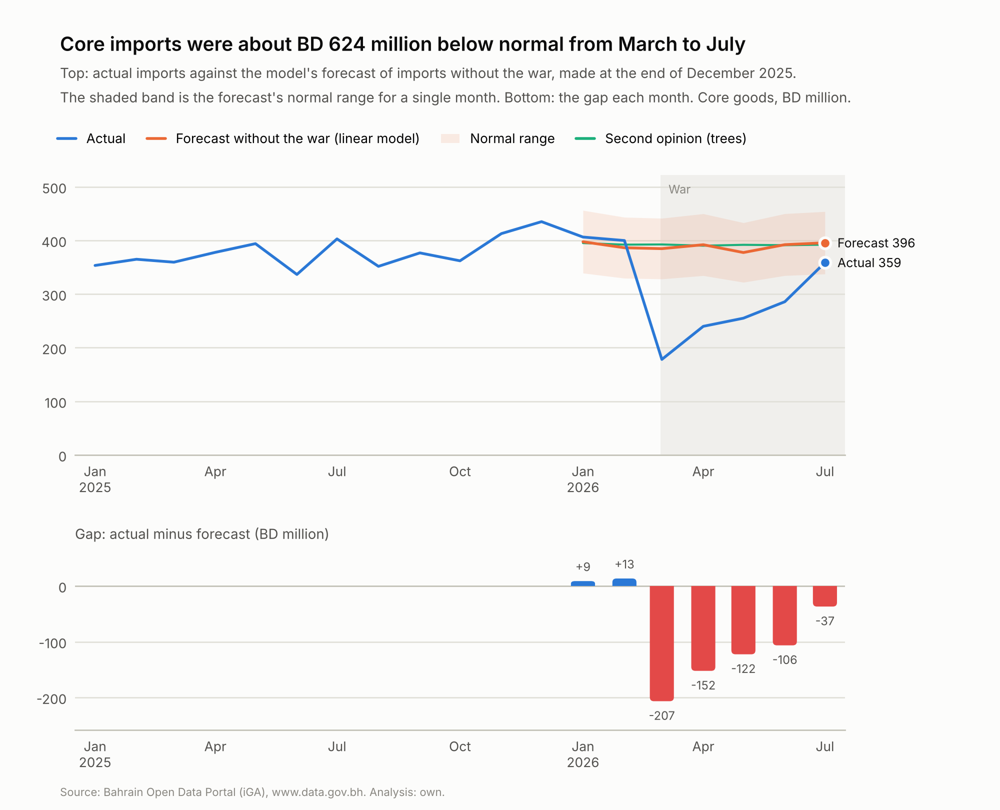

# Shock and Recovery: Bahrain's import supply chains in 2026

In 2026, war in the Gulf closed the Strait of Hormuz and, for more than a month, Bahrain's airspace. Almost everything
that reaches Bahrain by sea from outside the Gulf passes through that strait. This project uses Bahrain's official
monthly import statistics (1.76 million rows, January 2021 to July 2026), together with port and airport figures, to
measure how far imports fell below what they would have been without the war, which supply chains and routes broke,
and how far they had come back.

The core of the method is a counterfactual forecast. A model learns how imports normally behave, is tested on two
normal years to find out how wrong it usually is, and then forecasts 2026 as if nothing had happened. A shortfall only
counts if it is bigger than the model's normal misses.

**[Read the one-page summary](reports/summary.md)**, the [methodology note](docs/methodology.md), or the
[step-by-step reports](#reports).

## Key findings

- **Everyday imports fell 54% below normal in March 2026**, 36% in April-May and 18% in June-July. About **BD 624
  million (32%)** of goods didn't arrive from March to July, likely between BD 539 and 710 million.
- **Vehicles were hit hardest (-62%)**, and machinery and vehicles together were 64% of the money lost. Goods from the
  Americas and East and South-East Asia fell 48%, while **goods from GCC countries held up** (+8%, within the normal
  range).
- **Container ships and car carriers were the routes that broke.** Containers unloaded ran at about a third of normal
  from March to July, and car carriers unloaded no vehicles at all from April to September.
- **Goods got in another way.** Containers and planes could have carried at most 46% of what arrived by weight, so **at
  least 54% came over the King Fahd Causeway or by general cargo ship**. While planes could fly but ships couldn't pass
  Hormuz, light goods from far away fell 13% (leaving out aircraft engines) and heavy goods 54%.
- **Supply chains came back about two-thirds of the way by June-July.** Vehicles, clothing, East Asia and the Americas
  lagged. Port figures suggest they kept adapting after Hormuz closed again on 11 July.
- **Relying on few supplier countries didn't matter; relying on distant ones did.** Products bought from one or two
  countries fell about as far as products with many suppliers, while each extra 10% of a product from beyond the
  Middle East meant about 5 points further below normal. The lesson: diversify routes, not just countries.



## How it works

1. **Clean the data.** Six yearly import files in three slightly different formats become one table of 1.76 million
   rows (month × 8-digit product × origin country). Monthly totals are checked against the portal's own figures, and
   suspect rows are flagged rather than dropped, so the totals still match the official statistics.
2. **Decide what to forecast.** Exploring the data showed that bulk raw materials and gold behave very differently from
   everyday goods, that imports are only weakly seasonal but growing, and that the war stands out clearly at the level
   of customs chapter by origin region but drowns in noise at finer levels. Everyday ("core") goods are therefore split
   into about 660 series, one chapter from one origin region.
3. **Build and test the forecasts.** Four forecasts are compared: two simple rules, a **ridge regression written from
   scratch in NumPy** (solved with the normal equations and, as a check, by gradient descent; the two agree to
   floating-point precision) and **gradient-boosted trees** (scikit-learn). Each is tested on 2024 and 2025 as if it
   were January, so it never sees the months it forecasts. Choices were made on 2024 and checked once on 2025. The
   ridge regression won (national miss 5.5% a month in 2025, against 6.2% for last year's average month). Its misses
   set a "9 times out of 10" range for every total and period length; set on 2024, the ranges held 88-92% of the time
   in 2025.
4. **Measure the 2026 shortfall.** Actual imports are compared with the forecast nationally, by origin region and by
   product section. The trees give a second opinion (national gap -33% against -32%).
5. **Follow the routes.** Port and airport figures show which routes broke. Goods are grouped by the routes they can
   use (by origin, and by value per kg for goods from far away). The causeway publishes no figures, so its share is
   bounded by **elimination**: the most containers and planes could have carried, taken away from what arrived.
6. **Test a common piece of advice.** Products are profiled by their effective number of supplier countries and their
   share from beyond the Middle East, and a weighted regression with bootstrap ranges separates the two.

The [methodology note](docs/methodology.md) explains each choice, the alternatives and the trade-offs. Every report
and chart is generated by the scripts, so re-running the pipeline refreshes all of them.

## Reports

| Step | Question | Report | Script |
|---|---|---|---|
| 1 | Is the download complete? | (checks printed by the script) | `src/download_data.py`, `src/check_downloads.py` |
| 2 | How was the data cleaned? | [Cleaning the data](reports/step2_cleaning_report.md) | `src/build_dataset.py` |
| 3 | What does the data show, and what should the models forecast? | [Exploring the data](reports/step3_exploration.md) | `src/explore.py` |
| 4 | Which forecast is most accurate in normal years? | [Forecasting imports without the war](reports/step4_models.md) | `src/backtest.py` |
| 5 | How far below normal were imports? | [The 2026 shortfall](reports/step5_shortfall.md) | `src/shortfall.py` |
| 6 | Which routes broke, and how far had supply chains come back? | [Routes and adapting](reports/step6_routes.md) | `src/routes.py` |
| Extra | Did relying on few supplier countries matter? | [Supplier concentration](reports/extra_suppliers.md) | `src/suppliers.py` |
| 7 | The whole project in one read | [Summary](reports/summary.md) | `src/summary.py` |

## Reproducing the results

You need Python 3.10 or newer (developed on 3.14) and about 1 GB of disk space.

```bash
git clone https://github.com/Adel-10/bahrain-imports-2026.git
cd bahrain-imports-2026
python -m venv .venv
source .venv/bin/activate              # Windows: .venv\Scripts\activate
pip install -r requirements.txt        # or requirements-lock.txt for the exact versions used

python src/run_all.py                  # every step in order, about 4 minutes after the download
pytest                                 # tests (they don't need the data)
```

`run_all.py` downloads the data (about 0.4 GB) and runs every step. You can also run the steps one at a time:

```bash
python src/download_data.py        # step 1: download (skips files you already have)
python src/check_downloads.py      # step 1: check every month against figures read from the portal
python src/build_dataset.py        # step 2: clean and build the tables (about 20 s)
python src/explore.py              # step 3: exploration (about 10 s)
python src/backtest.py             # step 4: train and test the models (about 2 minutes)
python src/shortfall.py            # step 5: the 2026 shortfall (about 15 s)
python src/routes.py               # step 6: routes and adapting (about 15 s)
python src/suppliers.py            # extra: supplier concentration (about 20 s)
python src/summary.py              # step 7: the summary (a few seconds)
```

**Data snapshot.** The reports use data downloaded on 11 and 13-14 October 2026; `data/raw/MANIFEST.json` records each
file's download time and checksum. The portal adds months as they are published and the scripts pick them up
automatically, so a later download will extend the results rather than reproduce these exact numbers.
`check_downloads.py` says when a new month has appeared.

**Exact numbers.** `requirements-lock.txt` pins the package versions used. With other versions of scikit-learn the
gradient-boosted trees (the second opinion) can differ slightly; the main model's results don't depend on it.

## Data

All data comes from the [Bahrain Open Data Portal](https://www.data.gov.bh) (Information & eGovernment Authority).

| File | What it holds | Coverage |
|---|---|---|
| `imports_2021.csv` ... `imports_2026.csv` | Non-oil imports by 8-digit product code, origin country and month: value (BD, USD), weight (kg), quantity | Jan 2021 to Jul 2026 |
| `port_containers.csv` | Containers (TEU) at Khalifa Bin Salman Port, by type | 2019 onwards |
| `port_vessels.csv` | Ship visits at Khalifa Bin Salman Port, by type | 2019 onwards |
| `port_roro.csv` | Vehicles unloaded from car carriers at Khalifa Bin Salman Port | 2019 onwards |
| `port_general_cargo.csv` | General cargo (freight tonnes) at Khalifa Bin Salman Port | 2019 onwards |
| `airport_cargo.csv` | Air cargo (tonnes) at Bahrain International Airport | 2023 onwards |

`data/reference/events.csv` lists the dates used to label periods (COVID restrictions, the start of the war, the
Strait of Hormuz closures and reopening, the airspace closure and reopening, causeway closures), each with a source.

## Limitations

1. **The causeway has no published figures**, so the road's share is a minimum worked out by elimination, not a
   measurement.
2. **The normal ranges come from two test years** (2024 and 2025). More normal years would make them more reliable.
3. **Both models learn from the same five years**, so their agreement is reassuring but not independent proof.
4. **Customs months and arrival months don't always line up.** Periods of two months or more soften this.
5. **The port's general cargo figures needed repairs** and may include goods loaded for export, so no conclusion rests
   on them alone.

## What's next

- A "what if" range for the road's own share, under stated assumptions about container loads and general cargo.
- Updating with August 2026 onwards when the portal publishes it: the first months with Hormuz closed and no reopening.

## Repository layout

```
data/raw/            downloaded files, untouched (not committed; MANIFEST.json is)
data/interim/        forecasts and results passed between steps (not committed)
data/processed/      cleaned tables (not committed)
data/reference/      small hand-made tables: events, calendar, HS sections
docs/methodology.md  the methods, the alternatives considered and their trade-offs
src/config.py        dataset ids, paths, reference figures for the download checks
src/loaders.py       reads every file format into the same columns
src/reference.py     HS sections, product groups, origin regions, periods, calendar features
src/charts.py        shared chart style and drawing helpers
src/reporting.py     number formatting and markdown helpers for the reports
src/download_data.py, src/check_downloads.py   step 1
src/build_dataset.py                           step 2
src/explore.py                                 step 3
src/features.py      series and features for the models
src/models.py        simple rules, ridge regression from scratch, boosted trees
src/backtest.py, src/step4_report.py           step 4
src/shortfall.py, src/step5_report.py          step 5
src/routes.py, src/step6_report.py             step 6
src/suppliers.py, src/suppliers_report.py      extra: supplier concentration
src/summary.py                                 step 7
src/run_all.py       runs every step in order
tests/               pytest tests (run on every push by GitHub Actions)
reports/             reports (markdown) and figures/
```

## Data licence and attribution

Source: Bahrain Open Data Portal, www.data.gov.bh. The download date of each file is recorded in `data/raw/MANIFEST.json`. All analysis and transformation of the data in this project is my own and is not attributed to the iGA.

Datasets provided by the iGA via www.data.gov.bh are governed by the Terms of Use available at www.data.gov.bh/en/TermsOfUse. To the fullest extent permitted by law, the iGA is not liable for any damage or loss of any kind caused directly or indirectly by the use of the datasets or any derived analyses or applications.

## Licence

The code is released under the [MIT licence](LICENSE). The data remains under the portal's terms of use above.

---

By Adel Mithaiwala.
