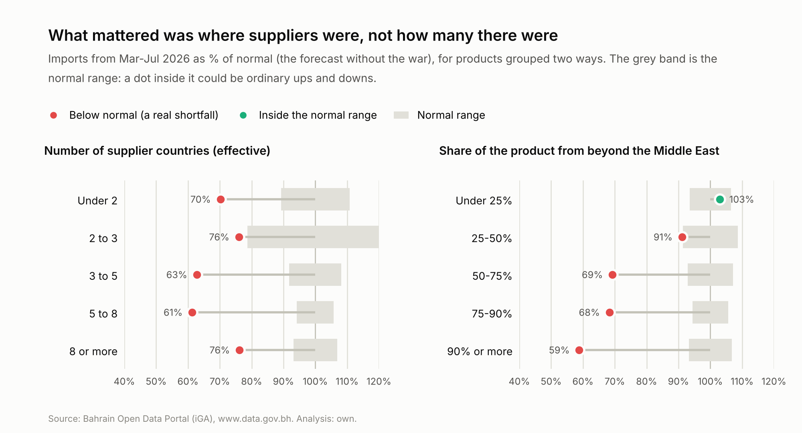
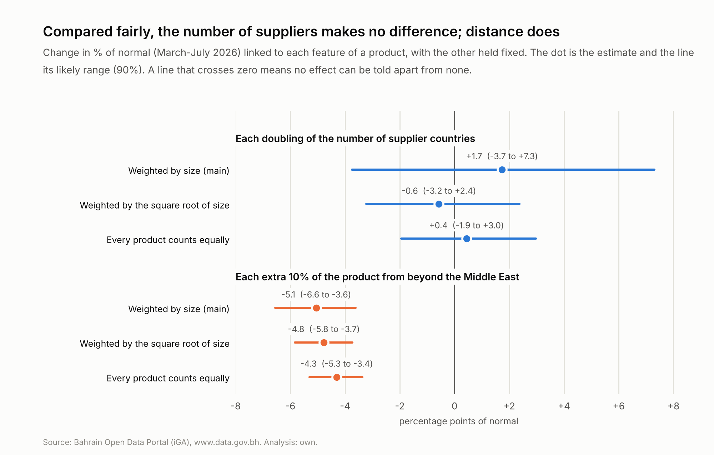
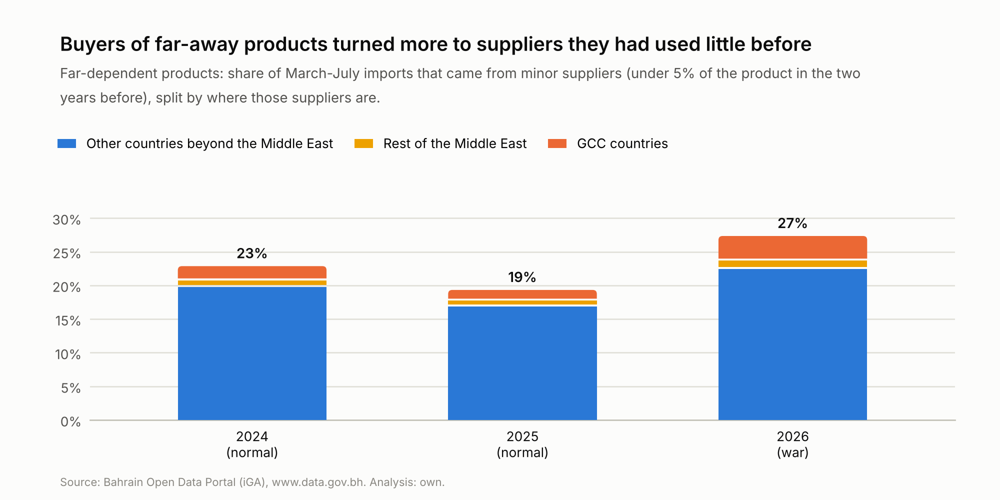

# Extra: Were products that relied on few supplier countries hit harder?

*Generated by `src/suppliers.py` (charts and text by `src/suppliers_report.py`). Re-running the script refreshes every
number.*

Steps 5 and 6 showed which kinds of goods and which origins were hit hardest. A common piece of supply-chain advice is
to **spread purchases across many supplier countries**, so that losing one doesn't matter much. This extra asks whether
that advice would have helped Bahrain in 2026:

1. Were products bought from only one or two countries hit harder than products with many suppliers?
2. If not, what did matter?
3. Did buyers switch to other suppliers during the war?

## The short answer

| Question | Answer |
|---|---|
| Were products with few supplier countries hit harder? | **No clear effect.** Every group fell a long way, to between 61% and 76% of normal from Mar-Jul, in no particular order. Compared fairly (with the share from far away held fixed), each doubling of the number of supplier countries changed a product's result by +1.7 points, likely between -3.7 and +7.3: **no measurable effect**, and small next to distance. |
| What did matter? | **Where the suppliers were.** Products bought mostly nearby (under 25% from beyond the Middle East) were at 103% of normal; products almost entirely from beyond the Middle East at 59%. Each extra 10% from beyond the Middle East meant about **5 points further below normal** (likely 3.6 to 6.6). The same holds however the products are weighted. |
| Did buyers switch suppliers? | **A little.** For products that normally come from far away, 27% of what arrived came from countries that had been minor suppliers, against 19-23% in normal years. Most of those were other distant countries; GCC suppliers' share of these products rose from 3-4% to 6%. |
| Why it matters | **Spreading purchases across many countries doesn't protect a supply chain if they all ship through the same strait.** Having suppliers on a different route does. |

## Words used in this report

| Word | What it means here |
|---|---|
| **Product** | One 4-digit HS heading, such as 8703 (cars) or 1006 (rice), from all origins together. Only products with imports in almost every month are used; together they are almost all of core goods by value. |
| **Forecast** | What step 4's linear model, rebuilt for each product, expected **without the war**. It was made at the end of December 2025, so it never saw any 2026 data. |
| **% of normal** | Actual as a percentage of normal: 100% is normal, 50% is half. (Step 5's gap of -54% is 46% of normal.) |
| **Normal range** | How far from the forecast a group's total can be in a normal year (9 times out of 10), measured by running the same product model on 2024 and 2025. |
| **Real shortfall** | A gap bigger than the normal range: too big to be ordinary ups and downs. |
| **Since the war** | March 2026 to the latest month the portal has published, added together. |
| **Supplier countries** (effective number) | How many countries a product really relied on in 2024-2025, allowing for their sizes: 1 / (sum of each country's squared share). Two equal suppliers give 2; 90% from one and 10% from another gives about 1.2. |
| **Share from beyond the Middle East** | The part of a product's 2024-2025 imports that came from beyond the Middle East, which normally has to pass the Strait of Hormuz or fly. |
| **Beyond the Middle East** | Goods from Asia, Europe, the Americas, Africa and Oceania (plus a small "not specified" group). Before the war these came mostly by sea through the Strait of Hormuz, or by plane. |
| **Typical product** | The median: half the products in the group did better, half did worse. Unlike the group total, it isn't dominated by a few big products such as cars. |
| **Regression** | A comparison that looks at several things at once, here the number of supplier countries and the share from beyond the Middle East, so the effect of each can be seen with the others held fixed. |
| **Likely range** | The regression re-run on 2,000 random re-draws of the products (bootstrapping); the middle 90% of the answers. If the range includes zero, the effect can't be told apart from no effect. |
| **Minor supplier** | A country that had supplied under 5% of a product in the two years before. |
| **Far-dependent product** | A product with at least 75% of its 2024-2025 imports from beyond the Middle East. |

---

## Before you start: how this extra works

### Step 1: Products and their forecasts

Each product is one 4-digit HS heading from all origins together. 844 products had imports in almost every
month before the war; together they are 98% of core goods by value. Step 4's linear model, rebuilt at this
level (as for step 5's close-ups), forecasts each one for 2026 as if there had been no war. Added up, the products were at
67% of normal from Mar-Jul, matching step 5.

### Step 2: How many countries did a product rely on?

Counting countries isn't enough: a product with one big supplier and ten tiny ones really relies on one. So each product
gets an **effective number of supplier countries** from its 2024-2025 imports:

> effective number = 1 / (sum of each country's share, squared)

* two countries with 50% each: 1 / (0.5² + 0.5²) = **2**;
* 90% from one and 10% from another: 1 / (0.9² + 0.1²) = **1.2**;
* four countries with 25% each: **4**.

### Step 3: How far away were its suppliers?

Each product also gets its **share from beyond the Middle East** in 2024-2025: the part that normally has to pass the
Strait of Hormuz or fly.

### Step 4: Comparing fairly

The two could be tangled together. If products with few suppliers also tended to come from far away, they would look
worse for the wrong reason. So, after comparing groups one way at a time, a **regression** looks at both at once, along
with value per kg (light goods could fly) and whether a product is a vehicle (car carriers stopped). Re-running it on
2,000 random re-draws of the products gives each effect a **likely range**.

---

## 1. Did relying on few countries matter?

**What we did:** grouped products by their effective number of supplier countries and compared each group's total with
its forecast, from Mar-Jul.

**What we found:**

| Supplier countries (effective) | Products | Share of value | From beyond the Middle East | % of normal (group total) | Typical product | Normal range | Real shortfall? |
|---|---|---|---|---|---|---|---|
| Under 2 | 108 | 12% | 82% | 70% | 67% | +/-11% | **yes** |
| 2 to 3 | 165 | 14% | 84% | 76% | 59% | +/-21% | **yes** |
| 3 to 5 | 279 | 30% | 78% | 63% | 62% | +/-8% | **yes** |
| 5 to 8 | 218 | 28% | 82% | 61% | 64% | +/-6% | **yes** |
| 8 or more | 74 | 16% | 79% | 76% | 65% | +/-7% | **yes** |

1. **Every group had a real shortfall**, falling to between 61% and 76% of normal.
2. **The order doesn't follow the number of suppliers.** Products with under 2 effective suppliers
   (70%) did better than the 5 to 8 group (61%). Big single
   products move the totals: cars, at 35% of normal and one of the biggest products, sit in the "5 to 8" group.
3. **Leaving out cars and aircraft engines**, the groups range from 67% to 76%,
   with a slight edge for products with more suppliers. Section 3 checks whether that edge survives once distance is
   allowed for. It doesn't clearly.
4. **The groups are about equally far-dependent**: each gets around 81% of its
   value from beyond the Middle East. That is a first hint that distance, not the number of countries, decides the result.

**The biggest products that relied on one or two countries (Mar-Jul):**

| Product | Main supplier | From beyond the Middle East | % of normal |
|---|---|---|---|
| Phones and network equipment | China (70%) | 100% | 57% |
| Refined copper | Democratic Republic of Congo (85%) | 98% | 46% |
| Wristwatches (other) | Switzerland (91%) | 100% | 90% |
| Rice | India (84%) | 100% | 88% |
| Wristwatches (precious metal) | Switzerland (97%) | 100% | 91% |
| Silicon | China (95%) | 96% | 50% |

Even these ranged from 46% to 91% of normal. Relying on one
country didn't decide how they fared.

---

## 2. What did matter?

**What we did:** grouped the same products by their share from beyond the Middle East.

**What we found:**

| From beyond the Middle East | Products | Share of value | Typical number of suppliers | % of normal (group total) | Typical product | Normal range | Real shortfall? |
|---|---|---|---|---|---|---|---|
| Under 25% | 61 | 6% | 1.9 | 103% | 98% | +/-6% | no |
| 25-50% | 71 | 10% | 4.3 | 91% | 83% | +/-9% | **yes** |
| 50-75% | 132 | 13% | 5.6 | 69% | 68% | +/-7% | **yes** |
| 75-90% | 141 | 17% | 4.9 | 68% | 59% | +/-6% | **yes** |
| 90% or more | 439 | 55% | 3.6 | 59% | 57% | +/-7% | **yes** |

1. **A clear staircase.** Products bought mostly nearby were at 103% of normal
   (inside the normal range).
   The more a product depended on far-away suppliers, the further it fell, down to 59% for
   products almost entirely from beyond the Middle East.
2. **The typical product tells the same story**, so it isn't just a few big products.

---

## 3. Both at once

**What we did:** a regression of each product's % of normal on its number of supplier countries (doubling), its share from
beyond the Middle East (per 10%), its value per kg (doubling) and whether it is a vehicle. Products are weighted by size,
so a BD 10 million product counts more than a BD 10,000 one. % of normal is capped at 200% so a few tiny products with
huge swings can't dominate.

**What we found:**

| Feature of the product | Change in % of normal | Likely range | A clear effect? |
|---|---|---|---|
| Each doubling of the number of supplier countries | +1.7 points | -3.7 to +7.3 | no (the range includes zero) |
| Each extra 10% of the product from beyond the Middle East | -5.1 points | -6.6 to -3.6 | **yes** |
| Each doubling of value per kg | +1.8 points | -0.8 to +4.6 | no (the range includes zero) |
| Vehicles and transport (compared with other goods) | -24.4 points | -31.8 to -9.7 | **yes** |

**The same check with other weightings:**

| Weighting | Each doubling of supplier countries | Each extra 10% from beyond the Middle East |
|---|---|---|
| Weighted by size (main) | +1.7 (-3.7 to +7.3) | -5.1 (-6.6 to -3.6) |
| Weighted by the square root of size | -0.6 (-3.2 to +2.4) | -4.8 (-5.8 to -3.7) |
| Every product counts equally | +0.4 (-1.9 to +3.0) | -4.3 (-5.3 to -3.4) |

1. **The number of supplier countries makes no measurable difference.** Every likely range includes zero. Even at
   the top of its main range (+7.3 points per doubling), going from a typical "under 2" product
   (1.5 suppliers) to a typical "8 or more" one (9.3) would be worth about 19 points,
   well below the 51 points between buying everything nearby and everything from far away.
2. **Distance makes a clear difference** under every weighting: about 5 points per extra 10% from
   beyond the Middle East. A product entirely from far away did about 51 points worse than one
   bought entirely nearby, everything else being equal.
3. **Vehicles did worse still**, even after allowing for distance: car carriers stopped altogether (step 6).

**Why it matters:** in this shock the danger was the **route**, not reliance on one country. Five suppliers in East Asia
all ship through the same strait, so having five of them gave no protection.

---

## 4. Did buyers switch suppliers?

**What we did:** for each product, found the countries that had supplied under 5% of it in the two years
before, and measured how much of each year's March-July imports came from them, in the war year and in normal years.

**What we found:**

|  | All products: from minor suppliers | Far-dependent products: from minor suppliers | ... of which minor suppliers in GCC countries | Far-dependent products: all GCC suppliers |
|---|---|---|---|---|
| 2024 (normal year) | 23% | 23% | 1.8% | 3.6% |
| 2025 (normal year) | 20% | 19% | 1.3% | 3.0% |
| 2026 (war) | 24% | 27% | 3.4% | 5.7% |

1. **Some switching happened, for the far-dependent products.** 27% of what
   arrived came from minor suppliers, against 19-23% in normal years.
2. **Most of it went to other distant countries**, not nearby ones. GCC suppliers' share of these products rose
   from 3-4% to 6%: almost double, but still small.
3. **Brand-new suppliers were rare**: 0.5% of far-dependent imports came from
   countries that hadn't supplied the product at all in the two years before.

**Why it matters:** buyers adapted by leaning on countries they already bought a little from, mostly other distant
ones whose goods could still get through, rather than by finding brand-new suppliers or switching to nearby ones.

---

## What this can't tell us

1. **Country of origin isn't the shipping route.** The customs data records where goods were made, not how they
   travelled. A Chinese product bought from a Dubai warehouse counts as Chinese.
2. **One heading can hold many items.** HS heading 8471 (computers) mixes laptops and parts, which may have different
   suppliers.
3. **Single products are hard to forecast**, so this extra compares groups and uses ranges and re-draws rather than
   reading much into any one product.
4. **The normal ranges come from two test years**, as in the rest of the project.

## What this means

The usual advice to "diversify suppliers" needs a twist for Bahrain: **diversify routes, not just countries.** Products
bought mostly from nearby countries, which can come by road, held up; products bought from far away fell a long way
whether they had one supplier or many.
