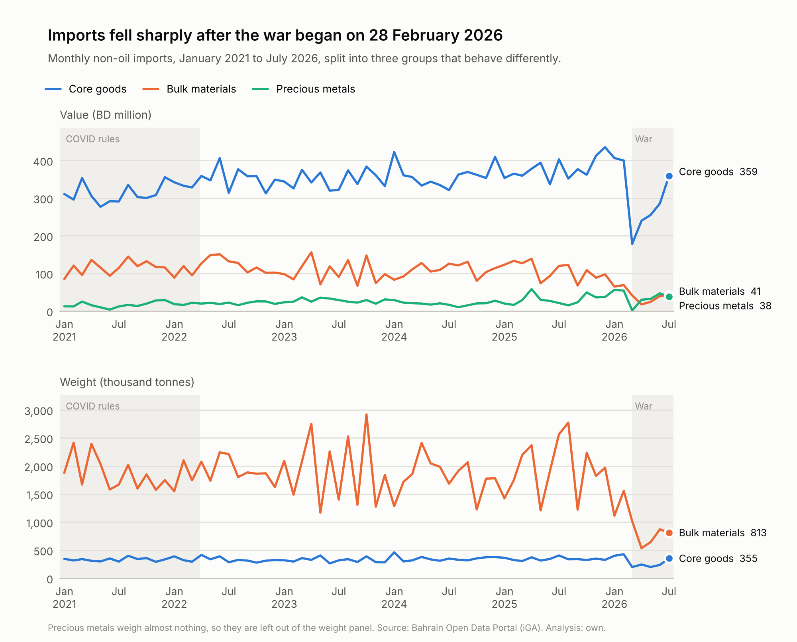
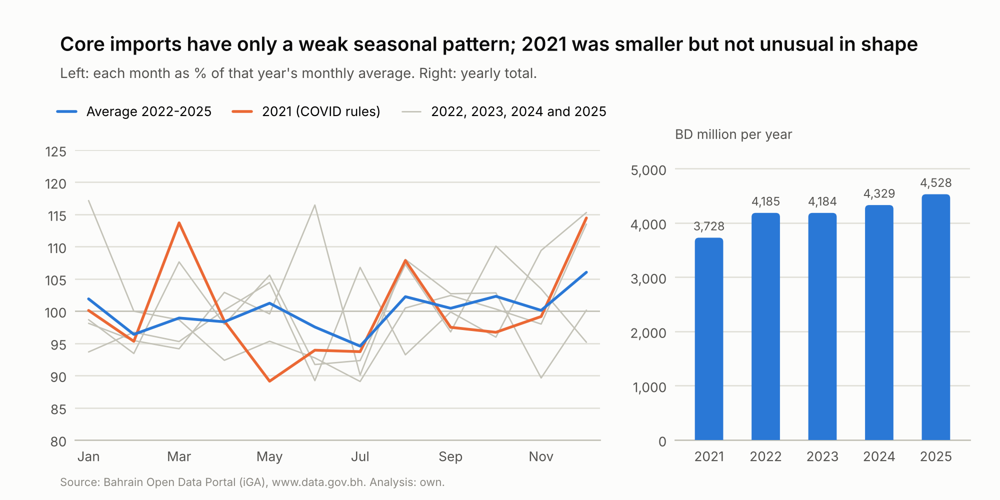
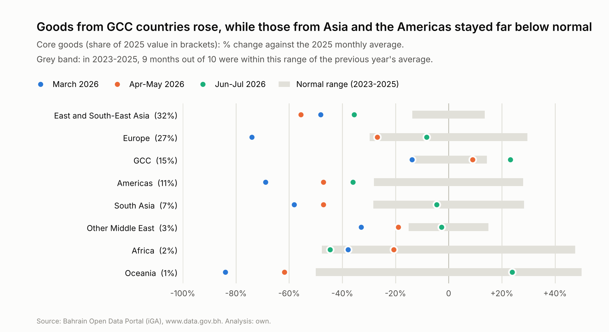
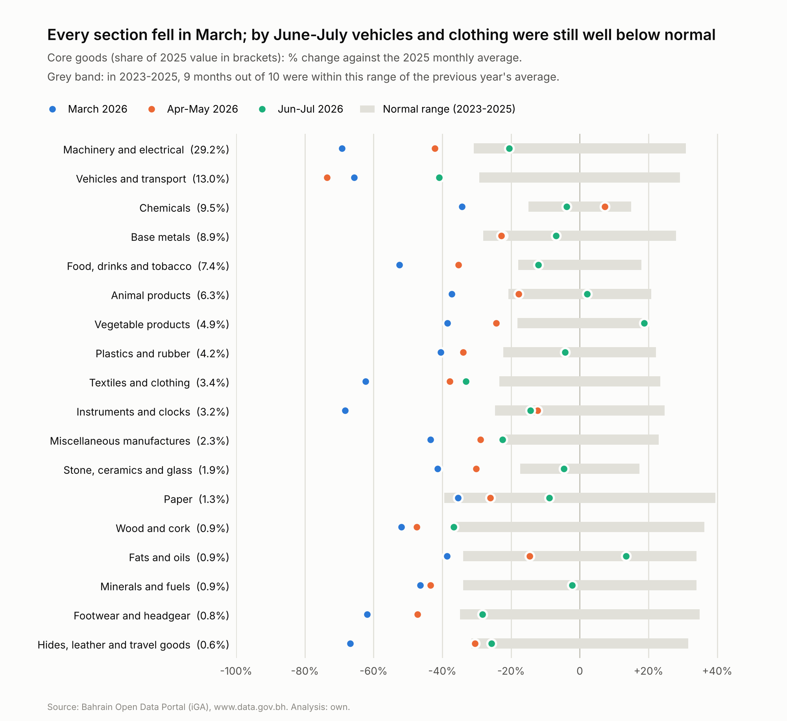
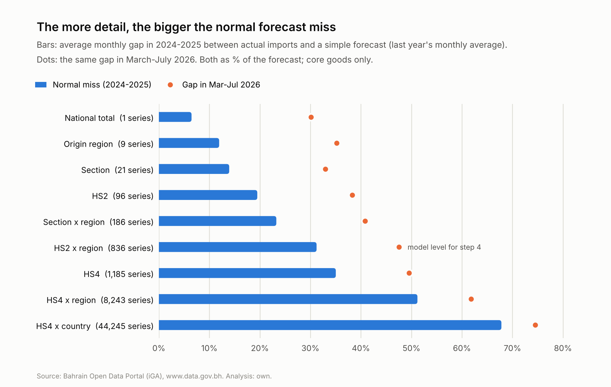

# Step 3: exploring the data

Generated by `src/explore.py` from the step 2 tables. Imports run from Jan 2021 to Jul 2026.

**How to read the numbers.** Unless stated otherwise, a change is measured against the **2025 monthly average** of the same thing,
so "-50" in March means March 2026 was half an average 2025 month. The 2026 periods follow the events in
`data/reference/events.csv`: **Jan-Feb** (before the war), **March** (shock: Strait of Hormuz and airspace closed, port struck),
**Apr-May** (airspace open again, Hormuz still closed, US blockade in force), **Jun-Jul** (a brief, partial reopening
from 18 June, then closed again on 11 July).

## 1. The big picture

Imports split into three groups that behave very differently, so from now on they are analysed separately:

| group | 2025 value (BD m) | % of 2025 value | % of 2025 weight | normal miss % | Jan-Feb | March | Apr-May | Jun-Jul |
|---|---|---|---|---|---|---|---|---|
| Core goods | 4,528 | 73 | 15 | 6 | +7 | -53 | -34 | -15 |
| Precious metals | 363 | 6 | 0 | 44 | +83 | -95 | +3 | +41 |
| Bulk materials | 1,294 | 21 | 85 | 16 | -38 | -62 | -81 | -63 |

*Normal miss: on average, how far a simple forecast (last year's monthly average) was from each month's actual value in
2024-2025, as % of the forecast. The last four columns are % changes against the 2025 monthly average.*

- **Core goods** (everything except bulk materials and precious metals) are the everyday supply chains and the main subject
  of the project. They were 7% above the 2025 average in Jan-Feb, 53% below
  it in March, and 15% below it by Jun-Jul.
- **Bulk materials** (iron ore, alumina, coke and construction minerals) arrive as whole shiploads for a few factories.
  They collapsed and stayed down: 63% below normal in Jun-Jul (section 4).
- **Precious metals** (gold, silver, jewellery) follow the gold price and a few very large shipments. They were already
  83% above normal in Jan-Feb, before the war, and their normal miss is about
  44%. They say little about supply chains, so they are reported separately and kept out of core goods.

## 2. What "normal" looks like

- **Seasonality is weak.** Only about 17% of the month-to-month movement in core goods (2022-2025)
  is a repeating calendar pattern; the rest is noise. The clearest pattern is December, about
  6% above the year's average. This is why "last year's monthly average" beats
  "the same month last year" as a forecast at every level of detail (section 6).
- **No clear Ramadan effect.** For food (HS sections I-IV), a full month of Ramadan changes imports by about
  +1% that month and -2% the month before, well within the noise.
  The calendar features stay in the models, but they are not expected to matter much.
- **Imports grow over time.** Core goods changed by 0% in 2023, +3% in 2024 and
  +5% in 2025, and were still rising going into 2026 (7% above the 2025 average in Jan-Feb).
  The models need features for the recent level and trend, not just last year's pattern.
- **2021 (COVID rules) was smaller but not unusual in shape.** Core goods were BD 3,728m in 2021 against
  4,185m in 2022 (2022 was 12% higher). May-June 2021, when malls and restaurants were closed, averaged
  92% of that year's monthly average, against 99% in 2022-2025, so the closures barely show.
  Whether to train on 2021 is tested in step 4, as planned.

## 3. Which origins were hit, and where goods came from instead

| origin region | % of 2025 | Jan-Feb | March | Apr-May | Jun-Jul | normal range +/- |
|---|---|---|---|---|---|---|
| East and South-East Asia | 32.3 | +12 | -48 | -56 | -36 | 14 |
| Europe | 27.4 | +2 | -74 | -27 | -8 | 30 |
| GCC | 15.0 | +8 | -14 | +9 | +23 | 14 |
| Americas | 10.9 | -9 | -69 | -47 | -36 | 28 |
| South Asia | 6.9 | +31 | -58 | -47 | -5 | 28 |
| Other Middle East | 3.4 | +17 | -33 | -19 | -3 | 15 |
| Africa | 2.0 | -4 | -38 | -21 | -45 | 48 |
| Oceania | 1.4 | -3 | -84 | -62 | +24 | 63 |

*Core goods. Normal range: in 2023-2025, 9 months out of 10 were within this many % of the previous year's average, so
changes inside it are not unusual. "Other and not specified" (under 1% of value) is left out.*

- **Goods from GCC countries rose.** They were 9% above normal in Apr-May and 23% above
  in Jun-Jul, and their share of core goods went from 15% in 2025 to 25% in Apr-May
  and 22% in Jun-Jul. GCC suppliers can reach Bahrain by road through Saudi Arabia, and UAE and Omani ports
  on the Gulf of Oman and Arabian Sea are outside the Strait of Hormuz. The largest increases in Jun-Jul (against the same months of
  2025) were copper plates and sheets (+BD 4.6m), semi-finished steel (+BD 2.2m) and poultry meat (+BD 2.1m).
- **East and South-East Asia**, the biggest origin (32% of core goods), stayed down longest:
  56% below normal in Apr-May and still 36% below in Jun-Jul. These goods normally come
  by container ship through Hormuz.
- **Europe** came back faster (8% below normal in Jun-Jul). Part of that is a few large aircraft-related
  deliveries: jet engines and gas turbines (+BD 29.3m) and aircraft engine parts (+BD 13.6m) against the same months of 2025. Even without aircraft, engines and their parts,
  Europe was 16% below normal, well ahead of Asia.

## 4. Which supply chains were hit

| section | % of 2025 | Jan-Feb | March | Apr-May | Jun-Jul | normal range +/- |
|---|---|---|---|---|---|---|
| Machinery and electrical | 29.2 | +2 | -69 | -42 | -20 | 31 |
| Vehicles and transport | 13.0 | +5 | -66 | -74 | -41 | 29 |
| Chemicals | 9.5 | +2 | -34 | +7 | -4 | 15 |
| Base metals | 8.9 | +38 | -22 | -23 | -7 | 28 |
| Food, drinks and tobacco | 7.4 | -13 | -52 | -35 | -12 | 18 |
| Animal products | 6.3 | +24 | -37 | -18 | +2 | 21 |
| Vegetable products | 4.9 | +5 | -38 | -24 | +19 | 18 |
| Plastics and rubber | 4.2 | -3 | -40 | -34 | -4 | 22 |
| Textiles and clothing | 3.4 | +19 | -62 | -38 | -33 | 23 |
| Instruments and clocks | 3.2 | +10 | -68 | -12 | -14 | 25 |
| Miscellaneous manufactures | 2.3 | +1 | -43 | -29 | -22 | 23 |
| Stone, ceramics and glass | 1.9 | +6 | -41 | -30 | -5 | 17 |
| Paper | 1.3 | -6 | -35 | -26 | -9 | 39 |
| Wood and cork | 0.9 | +4 | -52 | -47 | -37 | 36 |
| Fats and oils | 0.9 | +19 | -39 | -15 | +14 | 34 |
| Minerals and fuels | 0.9 | +35 | -46 | -43 | -2 | 34 |
| Footwear and headgear | 0.8 | +11 | -62 | -47 | -28 | 35 |
| Hides, leather and travel goods | 0.6 | 0 | -67 | -30 | -26 | 32 |

*Core goods by HS section. Sections under 0.5% of 2025 value, and the national special codes (confidential goods),
are left out of the chart and table.*

Every section fell in March. By Jun-Jul most were back inside their normal range, but vehicles and clothing were still well below it.
Food came back first: animal products, vegetable products and fats and oils were at or above normal by Jun-Jul.

**Bulk materials, by weight**

| material | kt per month (2025) | Jan-Feb | March | Apr-May | Jun-Jul |
|---|---|---|---|---|---|
| Iron ore | 1,080 | -53 | -69 | -100 | -95 |
| Construction minerals | 545 | -3 | -3 | -8 | +11 |
| Alumina | 262 | -12 | -64 | -73 | -34 |
| Petroleum and pitch coke | 67 | +6 | -9 | -79 | -83 |

Main origins (each listed origin supplied at least 10% of that material in 2025 or in Mar-Jul 2026):

| material | origin | kt per month, 2025 | kt per month, Mar-Jul 2026 |
|---|---|---|---|
| Iron ore | Brazil | 760.9 | 87.0 |
| Iron ore | Canada | 155.0 | 0.0 |
| Iron ore | Chile | 136.4 | 0.0 |
| Construction minerals | United Arab Emirates | 387.3 | 490.0 |
| Construction minerals | Sultanate Oman | 68.1 | 0.1 |
| Construction minerals | Saudi Arabia | 61.0 | 55.2 |
| Alumina | Australia | 255.4 | 64.1 |
| Alumina | Saudi Arabia | 2.2 | 16.1 |
| Alumina | India | 0.0 | 14.0 |
| Petroleum and pitch coke | Kuwait | 21.1 | 11.2 |
| Petroleum and pitch coke | Spain | 20.8 | 6.4 |
| Petroleum and pitch coke | China | 9.4 | 2.4 |
| Petroleum and pitch coke | Sultanate Oman | 7.0 | 0.2 |

- **Construction minerals show route exposure cleanly**: supplies from Oman, which have to pass through the Strait of Hormuz,
  stopped, while those from the UAE, inside the Gulf, rose.
- **Alumina from Australia** fell sharply and new suppliers appeared.
- **Iron ore** was already 53% below normal in Jan-Feb, before the war, so not all of its fall is the war.
- **Coke from Kuwait**, which does not need the Strait, had no shipments in May-July either. That may reflect lower demand from
  the factories (Alba, the aluminium smelter, was attacked on 28 March) rather than routes alone. Bulk materials mix route and
  factory effects, which is another reason to keep them separate from core goods.

## 5. Routes: did goods stop coming by sea and air?

| month | core goods value | core goods weight | containers unloaded | ships calling | air cargo unloaded |
|---|---|---|---|---|---|
| Jan 2026 | 108 | 117 | 115 | 99 | 93 |
| Feb 2026 | 106 | 125 | 91 | 94 | 98 |
| Mar 2026 | 47 | 58 | 36 | 43 | 1 |
| Apr 2026 | 64 | 71 | 37 | 46 | 11 |
| May 2026 | 68 | 58 | 22 | 71 | 52 |
| Jun 2026 | 76 | 69 | 30 | 62 | 71 |
| Jul 2026 | 95 | 104 | 33 | 61 | 64 |
| Aug 2026 |  |  | 47 | 66 | 67 |
| Sep 2026 |  |  | 48 | 59 |  |

*Each figure is % of that series' 2025 monthly average. Port = Khalifa Bin Salman Port, Bahrain's container port.*

In Jun-Jul, core goods were back to 85% of normal by value and 86% by weight,
but containers unloaded at the port were only 31% of normal and air cargo 67%.
So a much larger share than usual arrived some other way. The data covers the container port and the airport, so the
remaining route is mostly overland, by truck over the King Fahd Causeway from Saudi Arabia (smaller ports are also possible).
Section 3 points the same way: imports from GCC countries rose. Step 6 tests this properly.

## 6. How detailed can the forecasts be?

| level | series | regular series | % of value in regular series | normal miss % | same-month forecast miss % | 2026 gap % |
|---|---|---|---|---|---|---|
| National total | 1 | 1 | 100.0 | 6 | 8 | 30 |
| Origin region | 9 | 9 | 100.0 | 12 | 15 | 35 |
| Section | 21 | 20 | 100.0 | 14 | 17 | 33 |
| HS2 | 96 | 95 | 100.0 | 19 | 24 | 38 |
| Section x region | 186 | 160 | 100.0 | 23 | 30 | 41 |
| HS2 x region | 836 | 551 | 99.3 | 31 | 39 | 48 |
| HS4 | 1,185 | 846 | 99.1 | 35 | 43 | 50 |
| HS4 x region | 8,243 | 2,692 | 94.1 | 51 | 62 | 62 |
| HS4 x country | 44,245 | 5,268 | 82.7 | 68 | 80 | 75 |

*Core goods. A "series" is one line of monthly numbers, for example "HS2 chapter 84 from Europe". Regular series have imports in
at least 54 of the 60 months of 2021-2025. Normal miss and same-month forecast miss: average monthly gap in 2024-2025 between actual
imports and, respectively, last year's monthly average and the same month last year, as % of the forecast.*

- The national total is easy to forecast (normal miss about 6%), and the 2026 gap
  (about 30%) is far bigger than that.
- The more detail, the bigger the normal miss. At section level the 2026 gap is about
  2.4 times the normal miss; at HS4 it is only
  1.4 times, and at HS4 x country the normal miss
  (68%) is almost as big as the crisis itself.
- "Last year's monthly average" beats "the same month last year" at every level, so it is the simple forecast the models must beat.

Products that make the totals jumpy (general goods including precious metals, 2024-2025):

| HS4 | product | % of misses | % of value |
|---|---|---|---|
| 8409 | Aircraft engine parts | 7.9 | 5.2 |
| 7108 | Gold | 5.6 | 3.1 |
| 8411 | Jet engines and gas turbines | 5.4 | 2.2 |
| 8703 | Cars | 3.6 | 8.6 |
| 8517 | Phones and network equipment | 2.9 | 3.5 |
| 7113 | Jewellery | 2.4 | 2.9 |
| 3004 | Medicines | 1.4 | 2.9 |
| 7601 | Unwrought aluminium | 1.3 | 0.7 |

*% of misses: share of all the simple forecast's monthly misses that came from this product.* Gold and jewellery are why precious
metals are split out. Aircraft engines and parts are large, irregular purchases; they stay in core goods but are watched in step 5,
so that one delivery isn't mistaken for a recovery.

## Decisions for step 4

1. **Three groups, analysed separately**: core goods (the main analysis), bulk materials (by weight; few series, driven by
   shiploads and factory demand) and precious metals (reported, not used to judge supply chains).
2. **The simple forecast to beat** is last year's monthly average, with "same month last year" also reported.
3. **Bottom level for the models: HS2 chapter x origin region.** Its 551 regular series
   cover 99.3% of core goods; the patchy ones are pooled into one "other"
   series per section and region. Adding the forecasts up gives consistent totals by section, by origin region and for the whole
   country. HS4 forecasts are a check and are used for drill-downs (for example cars or phones).
4. **Results are reported at national, section and region level**, where the crisis is clearly bigger than the normal miss.
   Finer detail is shown only with its uncertainty range.
5. **Features for recent level and trend** (3-, 6- and 12-month averages), not just last year's same month, because imports
   were growing into 2026.
6. **2021 is tested both ways** (kept with a COVID flag, and left out).
