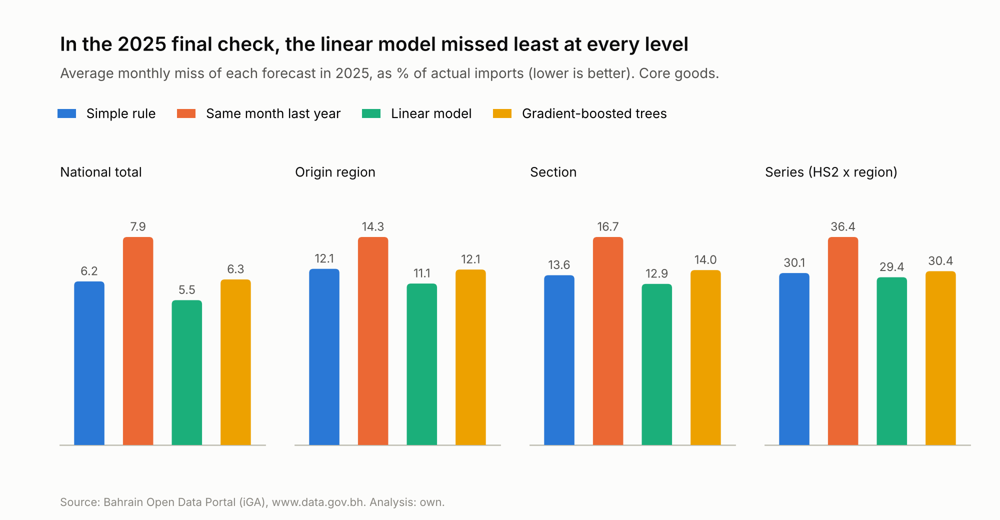
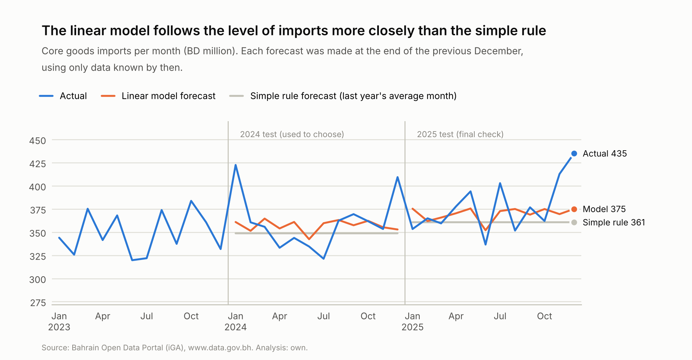
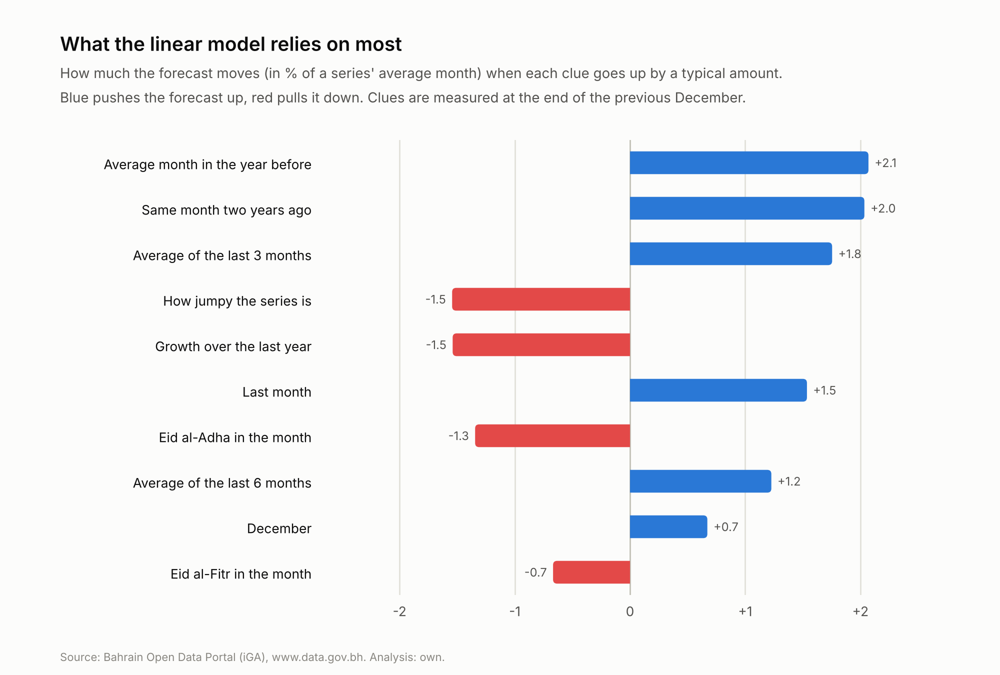
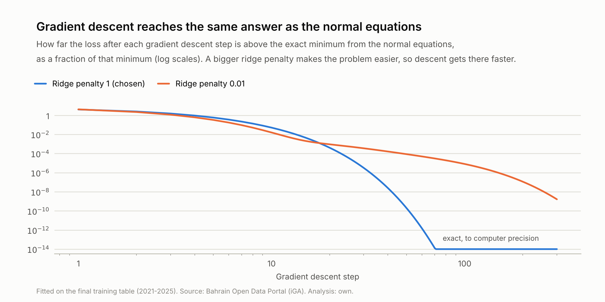

# Step 4: Building and testing the forecasting models

*Generated by `src/backtest.py` (charts and text by `src/step4_report.py`). Re-running the script refreshes every number.*

The whole project depends on one estimate: what imports **would have been in 2026 without the war**. This step builds
forecasting models to make that estimate. Before trusting them with 2026, each model is tested on two normal years,
2024 and 2025, to see how accurate it is and how far off it usually is.

## The short answer

| Question | Answer |
|---|---|
| Which forecast is most accurate in normal years? | **The linear model.** Nationally it missed by 5.5% a month on average in 2025, against 6.2% for the simple rule. |
| Should 2021 (the COVID year) be used? | **Yes.** The model is more accurate with it. |
| What does the model rely on? | **Mostly the recent level of imports, plus an allowance for growth.** Everything else makes only small adjustments. |
| How far off is it usually? | **A single month nationally can be up to 15% off** even in a normal year. These ranges were tested and they work. |
| Does it get January and February 2026 right? | **Yes.** Both months were within 4% of the forecast, before the war began on 28 February. |

## Words used in this report

| Word | What it means here |
|---|---|
| **Core goods** | All imports except bulk materials (iron ore, alumina, coke and construction minerals) and precious metals (gold, silver and jewellery). These are the everyday supply chains, about three-quarters of import value. |
| **National total** (also *nationally* or *All of Bahrain*) | All core goods imports into Bahrain in a month, added together: every product from every origin, in one number. It doesn't include bulk materials or precious metals, or oil (the portal's import data covers non-oil imports only). |
| **Origin region** | Where goods came from, grouped into 9 regions by how they normally reach Bahrain. **GCC** means Saudi Arabia, the UAE, Kuwait, Qatar and Oman, including the Jebel Ali and Oman free zones. |
| **Section** | One of the 21 top-level groups of the customs (HS) code, such as "Machinery and electrical" or "Vehicles and transport". Each section is made up of HS2 chapters. |
| **Series** | One line of monthly numbers: one HS2 chapter from one origin region, for example "chapter 84 (machinery) from Europe". |
| **Normal year** | A year without a major shock to imports. Here that means 2024 and 2025, the years used to test the models. |
| **Simple rule** | The simplest forecast: every month will be like last year's average month. |
| **Clue** | A piece of information the model uses to make a forecast, such as "the average of the last 3 months". Machine learning calls these *features*. |
| **Weight** | How much the linear model counts each clue. Machine learning calls these *coefficients*. |
| **Miss** | How far a forecast was from what actually arrived, ignoring whether it was too high or too low. Averaged over the months and shown as % of actual imports. Lower is better. (Step 3's "normal miss" divided by the forecast instead; see before-you-start, step 5.) |
| **Overall score** | The average of the miss for the national total, for origin regions and for sections: the three levels step 5 reports. Used to pick the winner. |
| **Total for the year** | Whether the forecasts, added up over the whole year, were too low or too high. |
| **Range** | How far from the model's forecast a single month can be in a normal year: 9 months out of 10 stay inside it. |
| **BD m, kt** | Million Bahraini dinars (value) and thousand tonnes (weight). |

---

## Before you start: how the test works

### Step 1: Pretend it's January

Each test copies exactly what will be done for 2026:

1. Stand at the end of December 2023 and use only data known by then.
2. Forecast every month of 2024.
3. Compare the forecasts with what actually arrived.
4. Repeat from the end of December 2024 for 2025.

### Step 2: What gets forecast

- The models forecast **core goods** (everything except bulk materials and precious metals, as decided in step 3).
- Core goods are split into **series**: one HS2 chapter from one origin region.
- A series needs imports in at least 90% of past months to be forecast on its own. The patchy ones are added together into
  one "other" series per section and region.
- That gives **663 series** (114 of them "other").
- Adding the series' forecasts together gives forecasts for each section, each origin region and the whole country.

### Step 3: The clues

For each series, the models get these clues, all known at the end of December:

| Clue | What it means |
|---|---|
| Recent level | Last month, and the average of the last 3, 6 and 12 months |
| Trend | Growth over the last year, and the average month in the year before that |
| Same month before | The same month last year and two years ago |
| How regular the series is | How jumpy it is, and how often it has months with no imports |
| Size and identity | How big the series is, its section and its origin region |
| Calendar | Month of the year, December, days of Ramadan, Eid, days in the month |
| COVID | Whether COVID rules applied in the month, or in the past 12 months |
| Months ahead | How far ahead the forecast is (1 to 12 months) |

Every clue is measured relative to the series' own average month, so a small series and a big one look alike to the models.

### Step 4: The four forecasts

1. **Simple rule:** every month will be like last year's average month. This is the yardstick from step 3.
2. **Same month last year:** every month will be like the same month a year earlier.
3. **Linear model**, written from scratch with NumPy:
   - It multiplies each clue by a weight and adds them up.
   - It picks the weights that make the squared misses on past data as small as possible.
   - A **penalty** stops any weight from getting too big. That pulls the model back towards the simple rule whenever
     the evidence for a clue is weak. (The technical name is ridge regression.)
4. **Gradient-boosted trees** (from scikit-learn):
   - Many small decision trees, each one correcting the mistakes of the ones before.
   - One model learns from all the series at once.
   - This is the method behind LightGBM, often the strongest choice for tables like this one.

When the models learn, big series count for more than small ones, because what matters in the end is the miss in Bahraini dinars.

### Step 5: How the forecasts are scored

The miss works like the normal miss in step 3, with one change: it is divided by the **actual** imports, not by the
forecast. With several models to compare, the actual is the fair yardstick because it is the same for all of them.
Dividing by the forecast would let a model look better just by forecasting too high.

### Step 6: Choose on 2024, confirm on 2025

1. **Choosing (2024):** every choice was made using the 2024 test only: each model's settings, and whether to use 2021.
2. **Final check (2025):** 2025 was used once, at the end, with the choices already fixed. Nothing was tuned on it, so it
   shows how the models do on a year they haven't seen. That is the situation 2026 will be in.

---

## 1. Which forecast is most accurate?

**What we did:** ran all four forecasts on 2024 and 2025.

**What we found:**

**2025: the final check**

| Forecast | National | By origin region | By section | Overall score | Total for the year |
|---|---|---|---|---|---|
| Simple rule (last year's average month) | 6.2% | 12.1% | 13.6% | 10.7% | 4.4% too low |
| Same month last year | 7.9% | 14.3% | 16.7% | 13.0% | 4.4% too low |
| **Linear model** | 5.5% | 11.1% | 12.9% | 9.9% | 2.0% too low |
| Gradient-boosted trees | 6.3% | 12.1% | 14.0% | 10.8% | 0.4% too low |

**2024: used for choosing**

| Forecast | National | By origin region | By section | Overall score | Total for the year |
|---|---|---|---|---|---|
| Simple rule (last year's average month) | 6.2% | 10.8% | 13.2% | 10.1% | 3.3% too low |
| Same month last year | 7.7% | 15.0% | 15.9% | 12.9% | 3.3% too low |
| **Linear model** | 5.4% | 10.4% | 13.0% | 9.6% | 1.0% too low |
| Gradient-boosted trees | 5.7% | 10.7% | 13.1% | 9.8% | 0.6% too high |

1. **The linear model wins in both years, at every level.** Nationally it missed by 5.5%
   in 2025, against 6.2% for the simple rule: about 11% smaller.
2. **Much of the gain comes from getting the level right.** Imports were growing, so the simple rule was
   4.4% too low over 2025. The linear model was 2.0% too low.
3. **"Same month last year" is the worst in both years**, as step 3 found.

**Why it matters:** the gain is modest, because most of a month's ups and downs are random and no model can predict them.
But it is consistent, and it held up on 2025, the year nothing was tuned on.

---

## 2. Why didn't the trees win?

Gradient-boosted trees are usually the strongest model for this kind of table, so it is worth explaining why they weren't here.

**Reason 1: set up the usual way, they forecast too low.**
- Trained to make the plain misses as small as possible, a model forecasts the *typical* (median) month of each series.
- In a lopsided series, a few big months sit among many small ones, so the typical month is below the average.
- Added up over hundreds of series, the trees' forecasts came out 4.6% too low in 2024.
- Training them to make the *squared* misses small instead makes them aim at the average month, which fixed it.

**Reason 2: there isn't enough history for their flexibility to pay off.**
- Trees can learn complicated patterns. With only four to five years of noisy monthly data, most of those patterns are noise.
- The best trees were the most restricted ones tried, with only 4 leaves each.
- In 2025 they still missed more than the linear model (10.8% against 9.9%
  overall), and slightly more than the simple rule (10.7%).

Every tree setup tried on 2024:

| Tree setup | National | By origin region | By section | Overall score | Total for the year |
|---|---|---|---|---|---|
| Aims at the typical month, big trees | 6.2% | 11.0% | 14.4% | 10.5% | 4.6% too low |
| Aims at the average month (Poisson method), medium trees | 6.9% | 11.2% | 14.5% | 10.9% | 1.1% too high |
| Aims at the average month (squared-miss method), medium trees | 7.0% | 11.4% | 14.8% | 11.1% | 1.3% too high |
| **Aims at the average month (squared-miss method), very small trees, less weight on the biggest series (chosen)** | 5.7% | 10.7% | 13.1% | 9.8% | 0.6% too high |

*Tree results can differ slightly (in the first decimal place) between scikit-learn versions; the conclusions don't change.*

---

## 3. How strong should the linear model's penalty be?

**What we did:** tried four strengths of penalty on 2024. A stronger penalty keeps the weights smaller, so the model stays
closer to the simple rule.

| Penalty strength | National | By origin region | By section | Overall score | Total for the year |
|---|---|---|---|---|---|
| 0.01 (very weak) | 6.5% | 11.2% | 13.6% | 10.4% | 0.3% too high |
| 0.1 (weak) | 6.2% | 11.0% | 13.4% | 10.2% | 0.2% too high |
| **1 (strong), chosen** | 5.4% | 10.4% | 13.0% | 9.6% | 1.0% too low |
| 10 (very strong) | 5.6% | 10.5% | 13.1% | 9.7% | 0.7% too low |

**What we found:** a strong penalty (1) works best.

**Why it matters:** apart from the recent level and growth, the evidence for most clues is weak, and a strong penalty
stops the model from chasing noise in the past data.

---

## 4. Should 2021 be used?

**What we did:** ran the chosen linear model on 2024 twice: learning from 2021-2023, and learning from 2022-2023 only.

| History used | National | By origin region | By section | Overall score | Total for the year |
|---|---|---|---|---|---|
| 2021-2023 (with 2021) | 5.4% | 10.4% | 13.0% | 9.6% | 1.0% too low |
| 2022-2023 (without 2021) | 5.5% | 10.8% | 14.3% | 10.2% | 2.0% too low |

**What we found:** the model is more accurate with 2021. Without it, there is only one year of history to learn from in
the 2024 test, which isn't enough to learn about trends.

**Why it matters:** 2021 stays in. The COVID clues tell the model which of its months were unusual.

---

## 5. What does the linear model rely on?

*How to read the chart: each bar shows how much the forecast moves, in % of the series' average month, when that clue
goes up by a typical amount (one standard deviation). From the final model, trained on 2021-2025. Section and region
adjustments are not shown.*

1. **A built-in allowance for growth.** When every clue is at its typical value, the model forecasts 3.6%
   above the series' average month over the last 12 months. That is roughly how much imports grew from one year to the next,
   and it fixes most of the simple rule's "too low" problem.
2. **Recent months pull the forecast their way.** If last month, or the last 3 or 6 months, were higher than usual, the
   forecast goes up a little.
3. **Part of last year's change tends to unwind.** If a series was higher in the year before than it is now, the forecast
   goes up a little (+2.1 on the chart). If it grew fast, the forecast comes down a little
   (-1.5).
4. **The same month two years ago** adds a little seasonal memory (+2.0).
5. **Holidays:** a month with Eid al-Adha is about 1.3% lower. December is about
   0.7% higher.

**Why it matters:** all the adjustments are small, a few % at most. That is the penalty at work: in normal years most of a
month's movement is noise, so the model only moves away from "recent level plus growth" when the evidence is clear.
Some clues overlap (for example the last 3 and the last 6 months), so the penalty shares the credit between them, and one
weight on its own should be read with care.

---

## 6. Checking the maths: two ways to find the weights

The linear model's weights were found in two different ways, both coded from scratch:

1. **Solve it directly ("normal equations").** The best weights satisfy one matrix equation, which can be solved in one go.
2. **Walk downhill ("gradient descent").** Start with every weight at zero. At each step, work out which direction lowers
   the misses fastest, and take a small step that way. Repeat.

If the code is right, both should end up with the same weights.

**What we found:**

- With the chosen penalty, walking downhill gets within 0.1% of the best answer after 19 steps,
  and matches it exactly (to the computer's precision) after 71 steps.
- With a very weak penalty (0.01), overlapping clues make the slope shallow near the bottom, so progress slows
  down. After 300 steps it is close, but still not exact.

*For readers who know the terms: the step size is 1/L, where L is the largest eigenvalue of the Hessian 2(X'WX + P), the
safe maximum for a quadratic loss. A bigger penalty improves the conditioning of X'WX, which is why descent converges faster.*

---

## 7. How far off is the model usually?

**What we did:**

1. Took the model's monthly misses in the 2024 and 2025 tests, for the national total, each origin region and each section.
2. For each total, found the distance that 9 months out of 10 stayed within. That is its **range**, the same idea as the
   normal range in step 3.

**Does the range work?** As a fair test, ranges were first set using 2024 only, then checked against 2025:

| Level | Months checked | Months inside the range |
|---|---|---|
| National total | 12 | 92% |
| Origin region | 108 | 88% |
| Section | 252 | 90% |

Between 88% and 92% of months fell inside, close to the 90% aimed for, so the ranges can be trusted.

**The final ranges** (set from 2024 and 2025 together):

| Total | Range for a single month |
|---|---|
| **Bahrain (national)** | **+/-15%** |
| GCC | +/-11% |
| East and South-East Asia | +/-12% |
| Other Middle East | +/-14% |
| South Asia | +/-23% |
| Americas | +/-23% |
| Europe | +/-29% |
| Africa | +/-45% |
| Oceania | +/-71% |
| Other and not specified | +/-109% |

*Sections range from +/-14% (Plastics and rubber) to
+/-153% (Arms and ammunition). All of them are saved in `data/interim/step4_ranges.csv`.*

**Why it matters:**
- In step 5, a 2026 month only counts as a real shortfall if it falls **outside** its range.
- Nationally, a single month can be 15% off even in a normal year. That is bigger than the average miss
  (5.5%), because the range has to cover the unusual months too, such as December.
- Small or jumpy origins have wide ranges, so a change there needs to be large before it counts.

---

## 8. Sanity check: January and February 2026

**What we did:** retrained the model on 2021-2025 and forecast 2026 from the end of December 2025, exactly as step 5 will.
The war began on 28 February, so January and February should look normal.

| Month | Forecast (BD m) | Actual (BD m) | Difference | Range | Inside the range? |
|---|---|---|---|---|---|
| January 2026 | 397.6 | 406.4 | +2.2% | +/-15% | yes |
| February 2026 | 386.5 | 399.9 | +3.5% | +/-15% | yes |

**What we found:**

1. **Nationally, both months land close to the forecast**, well inside the range.
2. **50 of 60** origin-region and section months were also inside their range.
3. Of the 10 outside it, **8 were above the forecast**, mostly in February. That could be stockpiling
   as tensions rose before the war, which step 5 will keep in mind.

**Why it matters:** the model gets the months before the war right, which supports using it for the months after.

### Extra check: every forecast on January-February 2026 (for information only)

Trees need a lot of history, so we also tested every forecast with all five years (2021-2025) to learn from, on the only
2026 months before the war:

| Forecast | National | By origin region | By section | Overall score | Total for the two months |
|---|---|---|---|---|---|
| Simple rule | 6.4% | 10.4% | 11.6% | 9.5% | 6.4% too low |
| Same month last year | 10.9% | 13.8% | 18.1% | 14.3% | 10.9% too low |
| **Linear model (chosen)** | 2.8% | 8.0% | 11.2% | 7.3% | 2.8% too low |
| Trees: Aims at the typical month, big trees | 7.2% | 11.3% | 14.8% | 11.1% | 7.2% too low |
| Trees: Aims at the average month (Poisson method), medium trees | 2.0% | 9.6% | 11.9% | 7.8% | 0.4% too high |
| Trees: Aims at the average month (squared-miss method), medium trees | 2.1% | 9.7% | 11.5% | 7.8% | 0.6% too high |
| Trees: Aims at the average month (squared-miss method), very small trees, less weight on the biggest series (chosen) | 2.3% | 7.8% | 11.2% | 7.1% | 2.3% too low |

With five years of history, the best trees did about as well as the linear model. Across all three tests, though, more
history doesn't steadily favour the trees:

| Test | Years of history to learn from | Linear model (overall score) | Best trees (overall score) |
|---|---|---|---|
| 2024 | 3 | 9.6% | 9.8% |
| 2025 | 4 | 9.9% | 10.8% |
| January-February 2026 | 5 | 7.3% | 7.1% |

This check is **not used to change the choice**, for four reasons:

1. **Two months is too few.** A difference of a few tenths of a percent over two months is well within normal noise.
2. **February may not be a normal month.** The war began on 28 February, and several totals were higher than expected
   (possibly stockpiling).
3. **It would use up the independent check.** Right now January-February is a clean test the model was never tuned on.
4. **Picking the best of several setups on a small test flatters the winner.** One of them will come out on top by luck.

Instead, step 5 uses the linear model for the main results and the best trees as a **second opinion**. If both models
tell the same story about 2026, the findings are stronger. If they disagree somewhere, that is reported.

---

## What this means for step 5

1. **The linear model** (strong penalty, trained on 2021-2025) gives the "without the war" forecast for each month of 2026.
   The forecasts are saved in `data/interim/step4_forecast_2026.parquet`. The best trees' forecasts, the second opinion,
   are saved alongside them.
2. **Each month of 2026 is compared with its own forecast**, for the whole country, each origin region and each section.
3. **A month only counts as a real shortfall if it falls outside its range** (saved in `data/interim/step4_ranges.csv`).
4. **Bulk materials and precious metals** have too few series for these models. Step 5 uses the simple rule for them,
   with their normal ranges from step 3.
