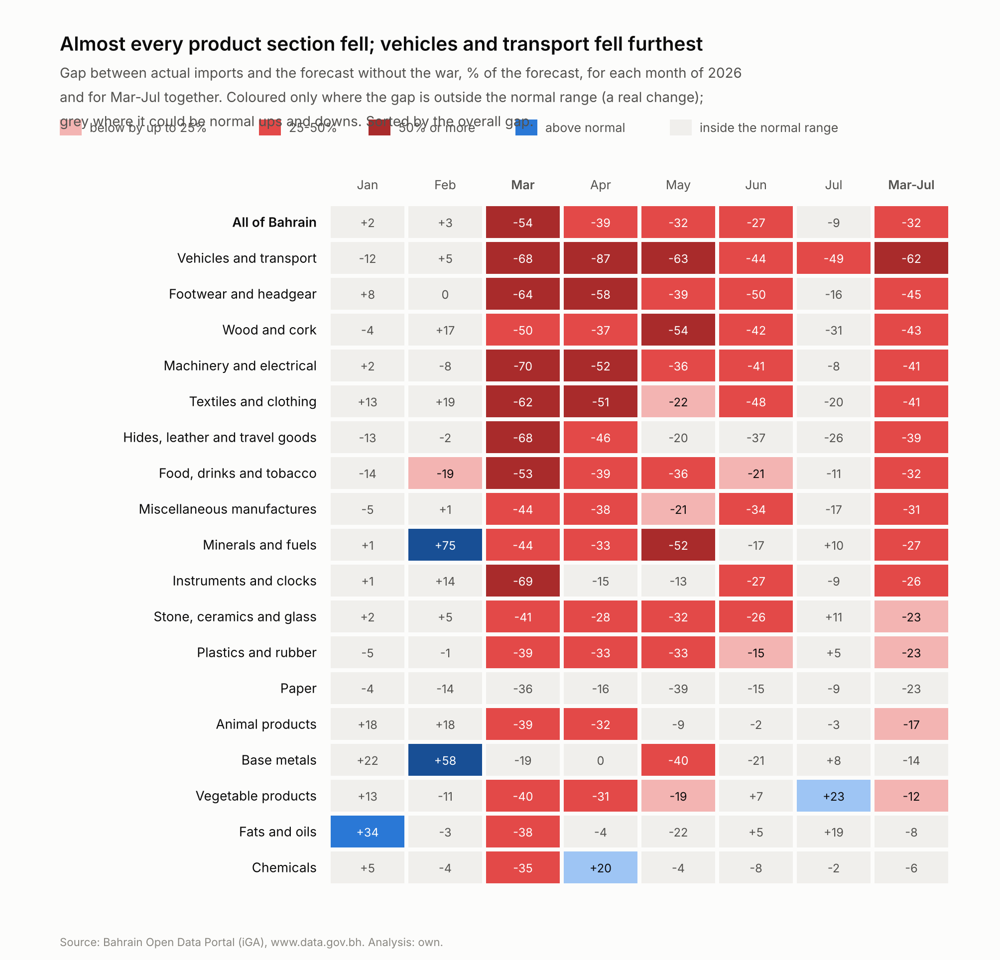
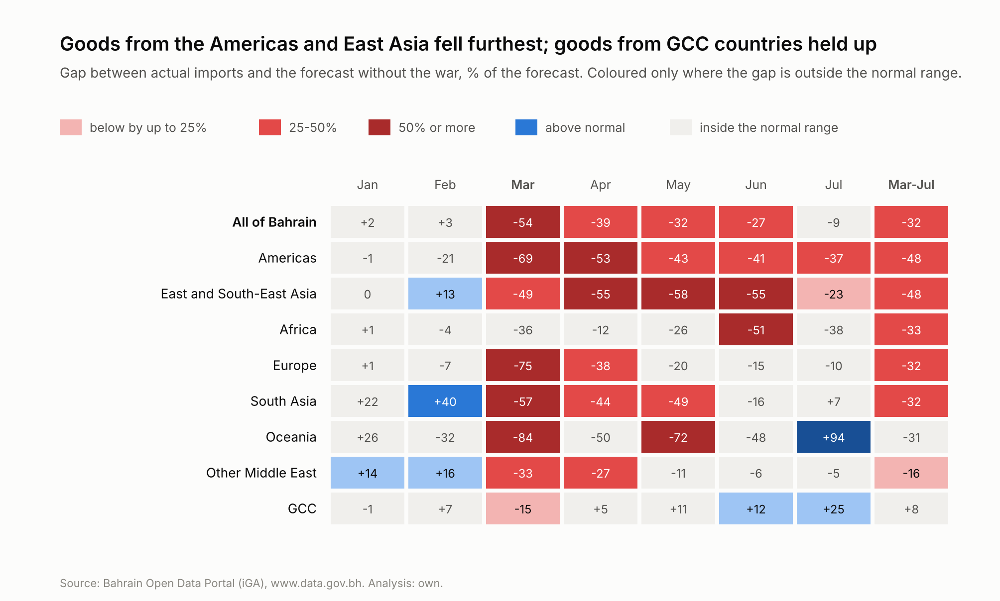
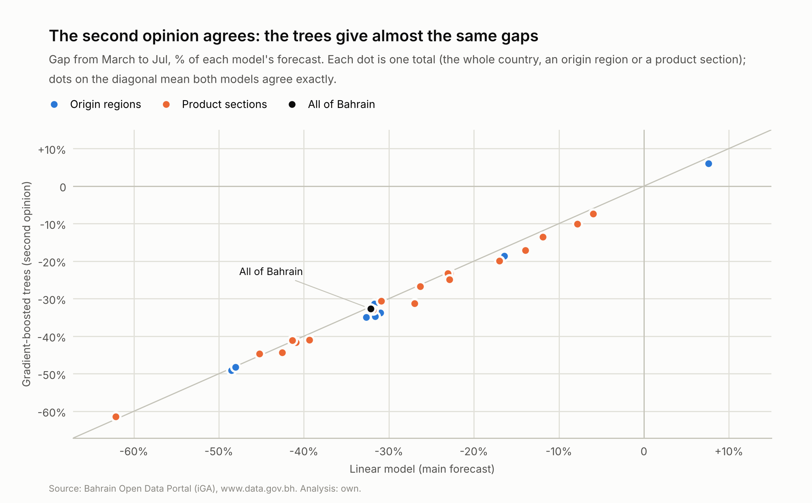
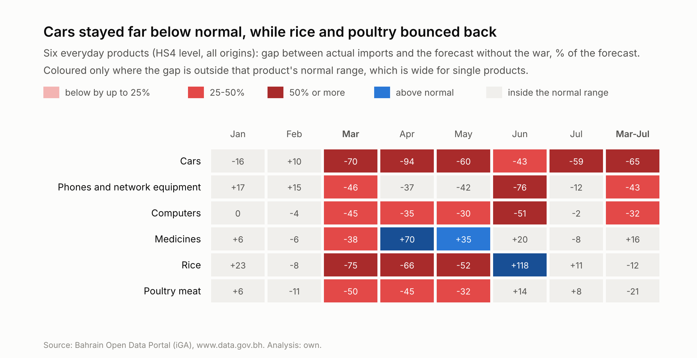

# Step 5: The 2026 shortfall

This is the main result of the project. Step 4 built and tested a model that forecasts what Bahrain would have imported without the war. Here every month of 2026 is compared with that forecast to measure how far below normal imports fell, how much was lost, and which supply chains were hit hardest.

## Key findings

- **Core imports fell 54% below normal in March**, then 36% in April-May and 18% in June-July. Each of these is far outside the model's normal range. By July the gap had narrowed to 9%, which on its own could be an ordinary month.
- **About BD 624 million of goods didn't arrive** from March to July (32% of what was expected), likely between BD 539 and 710 million.
- **Vehicles and transport fell furthest (-62%).** Machinery and electrical together with vehicles and transport account for 64% of the money lost.
- **Goods from the Americas (-48%) and East and South-East Asia (-48%) fell furthest.** These normally come by sea through the Strait of Hormuz. Goods from GCC countries held up (+8%, within the normal range).
- **The second model agrees.** Gradient-boosted trees put the national gap at -33%, against -32%, and every section and region within 4 percentage points.

## Method

The step 4 model stood at the end of December 2025 and forecast every month of 2026 using only what was known then. It was within 4% of January and February, before the war began on 28 February, so from March its forecast is the best available estimate of what would have arrived without the war.

For every month and period, and for every total (the whole country, each origin region, each product section), the **gap** is actual imports minus the forecast, also given as % of the forecast. The model is never exactly right, even in normal years, so a gap only counts as a real shortfall if it is bigger than the **normal range** for that total: the distance from the forecast that 9 out of 10 periods of the same length stayed within in step 4's tests on 2024 and 2025. Longer periods have narrower ranges, because over several months the model's ups and downs partly cancel out:

| Length of the period | Normal range for the national total |
|---|---|
| 1 month | +/-15% |
| 2 months | +/-8% |
| 5 months | +/-4% |

*National total. Ranges for every region and section are computed the same way.*

The amount **lost** is the forecast minus what arrived. Because the true "without the war" value could have been anywhere within the normal range, the loss is also given as a likely range.

Measuring against a tested forecast has two advantages over comparing with last year: the forecast already allows for growth and the calendar, and every claim that a gap is real is backed by the model's own track record. The weaknesses are that the result can only be as good as the model, the model can't know about anything else that would have changed in 2026, and the normal ranges rest on two test years.

The months of 2026 are grouped by what was happening:

| Period | What was happening |
|---|---|
| **Jan-Feb** | Before the war (it began on 28 February) |
| **March** | The shock: Strait of Hormuz and Bahrain's airspace closed, Mina Salman Port struck |
| **Apr-May** | Airspace reopened on 8 April, but Hormuz stayed closed and a US naval blockade began |
| **Jun-Jul** | A brief, partial reopening of Hormuz from 18 June, then closed again on 11 July |

## 1. The whole country

| Month | Forecast (BD m) | Actual (BD m) | Gap (BD m) | Gap | Normal range | Outside the range? |
|---|---|---|---|---|---|---|
| January | 398 | 406 | +9 | +2% | +/-15% | no |
| February | 386 | 400 | +13 | +3% | +/-15% | no |
| March | 385 | 178 | -207 | -54% | +/-15% | yes |
| April | 392 | 240 | -152 | -39% | +/-15% | yes |
| May | 378 | 255 | -122 | -32% | +/-15% | yes |
| June | 392 | 286 | -106 | -27% | +/-15% | yes |
| July | 396 | 359 | -37 | -9% | +/-15% | no |

January and February were normal, slightly above the forecast. March was the worst month, with imports at less than half the forecast (-54%). Each month after that was a little better, and by July the gap was -9%, inside the normal range for a single month.

| Period | Forecast (BD m) | Actual (BD m) | Gap | Normal range | Real shortfall? |
|---|---|---|---|---|---|
| Jan-Feb | 784 | 806 | +3% | +/-8% | no (inside the normal range) |
| March | 385 | 178 | -54% | +/-15% | **yes, below normal** |
| Apr-May | 770 | 495 | -36% | +/-8% | **yes, below normal** |
| Jun-Jul | 788 | 645 | -18% | +/-8% | **yes, below normal** |
| Since the war (Mar-Jul) | 1,942 | 1,318 | -32% | +/-4% | **yes, below normal** |

The fall is far too large to be noise. Even the smallest war-time gap (June-July, -18%) is 2.4 times the normal range for a two-month period.

## 2. How much was lost

| Period | Lost imports (BD m) | Likely between (BD m) |
|---|---|---|
| March | 207 | 150 and 263 |
| Apr-May | 275 | 216 and 333 |
| Jun-Jul | 143 | 83 and 203 |
| **Since the war (Mar-Jul)** | **624** | **539 and 710** |

About BD 624 million of core goods didn't arrive between March and July, 32% of what was expected. 77% of that was lost in March, April and May.

## 3. Product sections

| Section | Forecast (BD m) | Lost (BD m) | Gap | Normal range | Real shortfall? |
|---|---|---|---|---|---|
| Vehicles and transport | 265 | 165 | -62% | +/-12% | **yes, below normal** |
| Footwear and headgear | 17 | 8 | -45% | +/-16% | **yes, below normal** |
| Wood and cork | 17 | 7 | -43% | +/-29% | **yes, below normal** |
| Machinery and electrical | 575 | 238 | -41% | +/-19% | **yes, below normal** |
| Textiles and clothing | 64 | 26 | -41% | +/-12% | **yes, below normal** |
| Hides, leather and travel goods | 12 | 5 | -39% | +/-24% | **yes, below normal** |
| Food, drinks and tobacco | 144 | 46 | -32% | +/-7% | **yes, below normal** |
| Miscellaneous manufactures | 44 | 14 | -31% | +/-14% | **yes, below normal** |
| Minerals and fuels | 16 | 4 | -27% | +/-10% | **yes, below normal** |
| Instruments and clocks | 62 | 16 | -26% | +/-12% | **yes, below normal** |
| Stone, ceramics and glass | 36 | 8 | -23% | +/-7% | **yes, below normal** |
| Plastics and rubber | 78 | 18 | -23% | +/-12% | **yes, below normal** |
| Paper | 26 | 6 | -23% | +/-37% | no (inside the normal range) |
| Animal products | 125 | 21 | -17% | +/-13% | **yes, below normal** |
| Base metals | 164 | 23 | -14% | +/-14% | no (inside the normal range) |
| Vegetable products | 94 | 11 | -12% | +/-6% | **yes, below normal** |
| Fats and oils | 17 | 1 | -8% | +/-16% | no (inside the normal range) |
| Chemicals | 179 | 11 | -6% | +/-7% | no (inside the normal range) |

*Mar-Jul together. Sections under 0.5% of the national forecast, and national special codes, are left out.*

14 of 18 sections had a real shortfall; only paper, base metals, fats and oils and chemicals stayed inside their normal range. Vehicles and transport fell furthest (-62%), followed by footwear and headgear (-45%), wood and cork (-43%), machinery and electrical (-41%) and textiles and clothing (-41%). Most of the money was lost in two sections, machinery and electrical (BD 238m) and vehicles and transport (BD 165m), 64% of the total.

Food was hit early and then recovered. Animal products went from -39% in March to -3% in July; vegetable products went from -40% in March to +23% in July; food, drinks and tobacco went from -53% in March to -11% in July.

The goods that fell furthest (vehicles, machinery, clothing) are mostly made in Asia, Europe and the Americas and shipped in containers or on car carriers, while food can more easily be bought from nearby countries. Step 6 tests that explanation.

## 4. Origins

| Origin region | Forecast (BD m) | Lost (BD m) | Gap | Normal range | Real shortfall? |
|---|---|---|---|---|---|
| Americas | 211 | 102 | -48% | +/-10% | **yes, below normal** |
| East and South-East Asia | 633 | 304 | -48% | +/-5% | **yes, below normal** |
| Africa | 37 | 12 | -33% | +/-32% | **yes, below normal** |
| Europe | 538 | 171 | -32% | +/-10% | **yes, below normal** |
| South Asia | 128 | 41 | -32% | +/-12% | **yes, below normal** |
| Oceania | 26 | 8 | -31% | +/-34% | no (inside the normal range) |
| Other Middle East | 66 | 11 | -16% | +/-9% | **yes, below normal** |
| GCC | 289 | -22 | +8% | +/-10% | no (inside the normal range) |

*Mar-Jul together.*

The Americas (-48%) and East and South-East Asia (-48%) fell furthest, and because Asia is the biggest origin it also lost the most money (BD 304m). Europe fell less (-32%); by July it was -10%, against -23% for East and South-East Asia. Goods from GCC countries held up (+8%, inside the normal range): they can reach Bahrain by road, or by sea without passing through the Strait of Hormuz.

This is the clearest sign so far that the route mattered more than the product. Step 6 looks at it directly.

## 5. Second opinion

Everything above was repeated with step 4's best gradient-boosted trees, each total judged against the trees' own normal ranges. Nationally the trees give -33%, against -32% with the linear model. For sections and regions the two models' gaps differ by 1.5 percentage points on average and by at most 4.2, and they agree on whether the gap is real for 25 of 27 totals. They differ only for base metals (linear -14% against a range of +/-14%; trees -17% against +/-12%) and Oceania (linear -31% against a range of +/-34%; trees -34% against +/-30%), borderline cases where the gap sits right at the edge of the normal range.

Two quite different kinds of model tell the same story, so the findings don't hinge on the choice of model. They are not fully independent, though: both learned from the same five years of data.

## 6. Six everyday products

The same linear model was rebuilt at 4-digit level, where each series is one product from all origins together. At this level the model barely beats the simple rule (it missed by 32.9% against 33.2% in the 2025 test), so the normal ranges are wide and these results are illustrations rather than headline findings.

Cars fell hardest and stayed down: -70% in March and still -51% in June-July. They normally arrive on car carriers through the Strait of Hormuz. Phones and computers were well below normal throughout (-43% and -32% from March to July). Rice and poultry bounced back: rice went from -75% in March to +65% in June-July, above normal, which looks like restocking, and poultry from -50% to +11%. Medicines dipped in March (-38%) and then came in above normal in April-May (+53%), which looks like catching up or building stocks.

## 7. The aircraft effect

Aircraft, engines and parts are large, irregular purchases that can make a month look better or worse than everyday supply chains really were. The table recomputes the national gap as if they had arrived at their normal 2025 level:

| Month | Aircraft, engines and parts (BD m) | Their normal month (BD m) | Gap, as measured | Gap with aircraft at normal |
|---|---|---|---|---|
| January | 48.4 | 35.8 | +2% | -1% |
| February | 23.3 | 35.8 | +3% | +7% |
| March | 0.5 | 35.8 | -54% | -45% |
| April | 11.2 | 35.8 | -39% | -33% |
| May | 33.0 | 35.8 | -32% | -32% |
| June | 30.7 | 35.8 | -27% | -26% |
| July | 38.1 | 35.8 | -9% | -10% |

In March they made the drop look deeper: almost none arrived (BD 0.5m against a normal BD 35.8m), and without that swing March would have been -45% instead of -54%. From May they were close to normal, so they don't explain the later months or the recovery.

## 8. Bulk materials and precious metals

These groups have too few series for the models, so they are compared with the 2025 average month, with normal ranges from 2023-2025 (as in step 3). Bold means outside the normal range.

**Bulk materials, by weight**

| Material | March | Apr-May | Jun-Jul | Since the war (Mar-Jul) |
|---|---|---|---|---|
| All bulk materials | **-48%** | **-70%** | **-57%** | **-60%** |
| Iron ore | -69% | **-100%** | **-95%** | **-92%** |
| Alumina | **-64%** | **-73%** | **-34%** | **-56%** |
| Petroleum and pitch coke | -9% | **-79%** | **-83%** | **-67%** |
| Construction minerals | -3% | -8% | +11% | +1% |

Iron ore almost stopped and alumina fell by about half; both come by sea through the Strait of Hormuz, from Brazil and Australia. Construction minerals didn't change, because they come mainly from the UAE, inside the Gulf.

**Precious metals, by value**

| Period | Gap against the 2025 average month | Normal range | Outside? |
|---|---|---|---|
| Jan-Feb | +83% | +/-83% | no |
| March | -95% | +/-79% | yes |
| Apr-May | +3% | +/-83% | no |
| Jun-Jul | +41% | +/-83% | no |
| Since the war (Mar-Jul) | -1% | +/-59% | no |

Apart from March, precious metals stayed within their very wide normal range: they follow the gold price more than supply routes.

## Limitations

- **The forecast is a model, not an observation.** Anything else that would have changed imports in 2026 (prices, big projects, policy) is not in it.
- **The normal ranges rest on two test years**, and the ranges for periods of several months on even fewer independent data points.
- **Customs months and arrival months don't always match**, which can move goods between neighbouring months. Two-month periods soften this.
- **Product close-ups are noisy**: single products have wide ranges, so only large changes can be called real.

## What step 6 takes from this

Core goods were about BD 624 million below normal from March to July, worst in March and recovering steadily after. Goods that normally pass through the Strait of Hormuz fell furthest, while GCC goods held up. Step 6 tests the route explanation directly, by grouping goods by how they normally travel and by comparing them with the port, airport, car-carrier and general cargo figures.

---

*This report is generated by `src/shortfall.py` (charts and text in `src/step5_report.py`). Re-running the pipeline (`python src/run_all.py`) refreshes every number and chart. Data: Bahrain Open Data Portal (iGA), www.data.gov.bh.*
