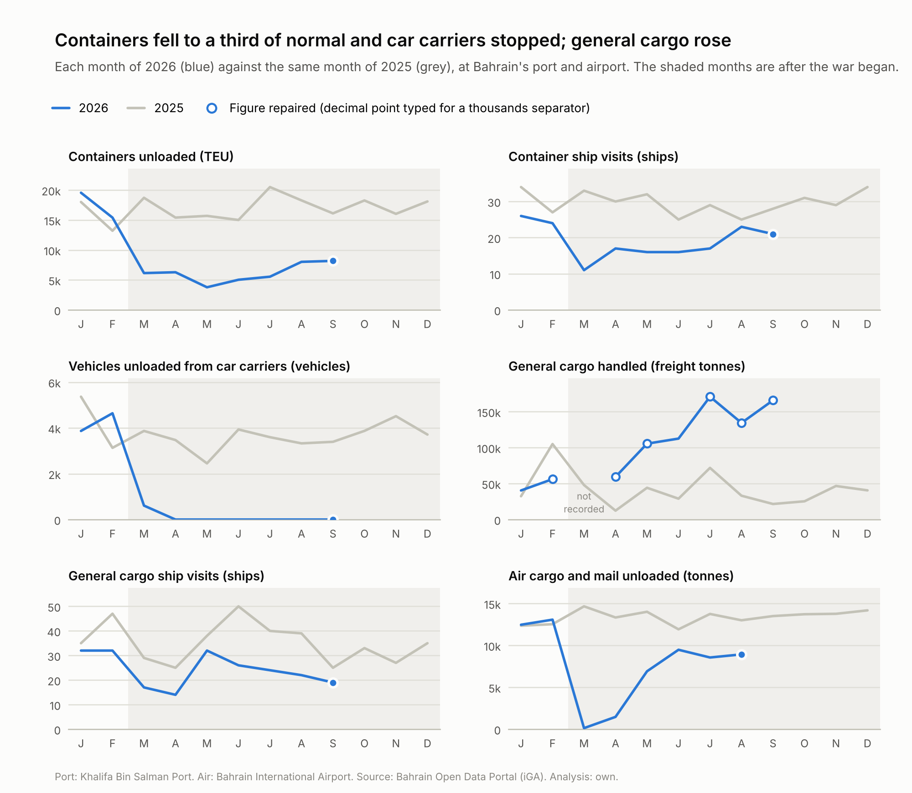
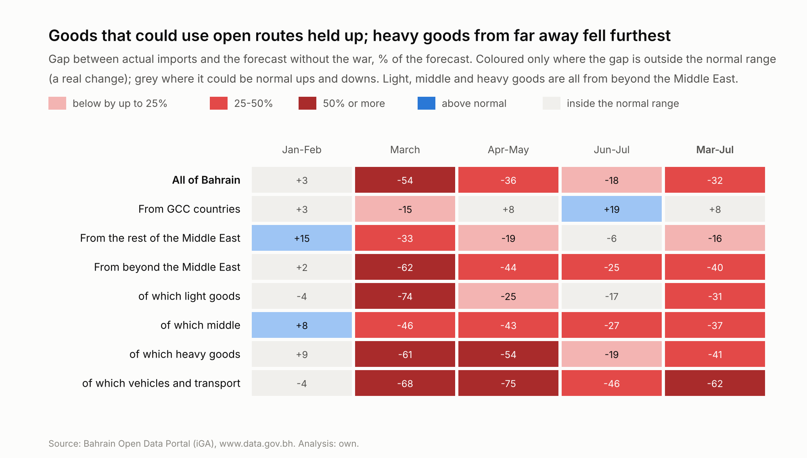
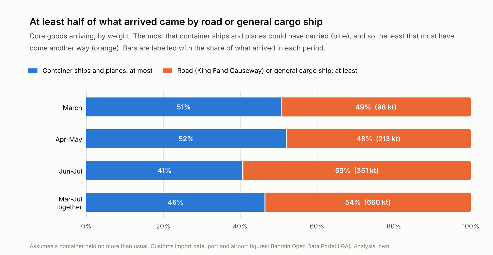
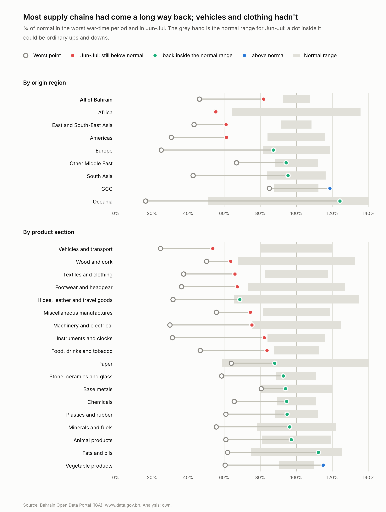

# Step 6: Routes and adapting

Step 5 measured how far imports fell. This step asks how goods reached Bahrain while the Strait of Hormuz was closed: which routes were cut, whether goods that could use another route held up better, how much must have come by road (the one route with no published figures), and how far each supply chain had come back.

## Key findings

- **Container ships and car carriers were the routes that broke.** Containers unloaded ran at about a third of normal from March to July (33%, 32% and 30% in March, Apr-May and Jun-Jul), and car carriers unloaded no vehicles at all from April to September. Air cargo was almost zero in March, while the airspace was closed, and back to 70% of normal by Jun-Jul.
- **Goods with another way in held up.** Goods from GCC countries, which can come by road, were +8% against the forecast from Mar-Jul, within the normal range; goods from beyond the Middle East were -40%. In April-May, when planes could fly but ships couldn't pass Hormuz, light goods from far away fell 13% (leaving out aircraft engines) and heavy goods 54%.
- **At least 54% of what arrived came by road or general cargo ship.** Container ships and planes could have carried at most 46% of core goods by weight from Mar-Jul, even on generous assumptions, leaving at least 660 thousand tonnes for the King Fahd Causeway and general cargo ships.
- **Supply chains came back about two-thirds of the way by Jun-Jul**, from 46% of normal in March to 82%. Vehicles (54%), East Asia (61%) and the Americas (61%) were still far below normal.
- **Supply chains seem to have kept adapting after Hormuz closed again.** The port figures, which run two months ahead of the import data, show containers unloaded rising from 30% of normal in Jun-Jul to 47% in Aug-Sep.

## Method

### The five routes

| Route | Where | What it carries | Monthly figures |
|---|---|---|---|
| Container ships | Khalifa Bin Salman Port | Most manufactured goods from Asia, Europe and the Americas | Containers unloaded (TEU), ship visits |
| Car carriers (RoRo) | Khalifa Bin Salman Port | New cars and other vehicles | Vehicles unloaded |
| General cargo ships | Khalifa Bin Salman Port | Steel, timber, machinery, bagged food, livestock | Freight tonnes handled, ship visits |
| Planes | Bahrain International Airport | Light, valuable or urgent goods | Tonnes unloaded |
| Trucks over the King Fahd Causeway | From Saudi Arabia | Goods from GCC countries, and goods landed at their ports | **None published** |

Everything that reaches Bahrain by sea from outside the Gulf passes through the Strait of Hormuz. The causeway comes from Saudi Arabia, so it carries goods from GCC countries, and goods from further away that were landed at Saudi, Emirati or Omani ports and driven the rest of the way. It is the one route with no monthly figures, so its role has to be worked out from the others.

### Two kinds of "normal"

Imports are compared with step 5's forecast of what would have arrived without the war, with the same tested normal ranges. Port and airport figures have no forecast, so each 2026 month is compared with the same month of 2025. The changes there are so large (often more than half) that the choice of yardstick doesn't change the picture.

### Grouping goods by the routes they can use

The customs data records where goods came from, not how they travelled, so two groupings stand in for route:

- **By origin**: GCC countries (road, or short sea trips inside the Gulf), the rest of the Middle East (long overland routes) and beyond the Middle East (normally by sea through Hormuz, or by air).
- **By value per kg**, for goods from beyond the Middle East: light goods (BD 5 a kg or more, worth flying), heavy goods (under BD 1 a kg, almost never flown), middle goods in between, and vehicles on their own because they travel on car carriers. Each series is classed by its 2024-2025 value per kg.

If air helped, light goods should have held up better than heavy ones once the airspace reopened on 8 April, while Hormuz was still shut. These groupings are proxies: a good from China might have been flown to Riyadh and trucked in, and a light series can contain some heavy items.

### Elimination

The causeway publishes nothing, but its share can be bounded. For each period, by weight of core goods:

1. The most containers could have carried is last year's weight scaled by the change in containers unloaded, as if everything had come in containers last year. That overstates what containers carry, on purpose.
2. Add all air cargo unloaded, as if every tonne were core goods, which also overstates it.
3. Whatever is left must have come another way: by truck over the causeway or by general cargo ship.

Every assumption favours containers and planes, so the result is a minimum for the road and general cargo together. The only assumption that could push the other way is that a container held no more than usual. The bound can't separate the road from general cargo ships.

### Periods

| Period | What was happening | Import data |
|---|---|---|
| **Jan-Feb** | Before the war (it began on 28 February) | yes |
| **March** | The shock: Strait of Hormuz and Bahrain's airspace closed, Mina Salman Port struck | yes |
| **Apr-May** | Airspace reopened on 8 April, but Hormuz stayed closed and a US naval blockade began | yes |
| **Jun-Jul** | A brief, partial reopening of Hormuz from 18 June, then closed again on 11 July | yes |
| **Aug-Sep** | Hormuz closed again from 11 July (still closed in October) | not yet (port and airport figures only) |

The port and airport publish about two months before the import data, so they also show Aug-Sep.

## 1. Which routes were cut?

| Indicator | Jan-Feb | March | Apr-May | Jun-Jul | Aug-Sep |
|---|---|---|---|---|---|
| Containers unloaded | 112% | 33% | 32% | 30% | 47% |
| Container ship visits | 82% | 33% | 53% | 61% | 83% |
| Vehicles unloaded from car carriers | 100% | 16% | 0% | 0% | 0% |
| General cargo handled | 70% | - | 292% | 281% | 548% |
| General cargo ship visits | 78% | 59% | 73% | 56% | 64% |
| Air cargo and mail unloaded | 103% | 1% | 31% | 70% | 69% |
| Core goods imported, by weight | 120% | 65% | 65% | 79% | - |

*% of the same months of 2025. A dash means no figure yet. General cargo varies a lot from month to month (in 2025, from 12,372 to 105,028 freight tonnes); against the 2025 average month, Aug-Sep 2026 was 3.5 times normal.*

Containers fell by about two-thirds and stayed there: from March to July the port unloaded about a third of the usual containers in every period, as fewer container ships called and those that did unloaded less. Car carriers stopped. Vehicles unloaded fell to 16% of normal in March and to zero from April, still zero in September. Planes came back slowly: air cargo was 1% of normal in March, while the airspace was closed until 8 April, 31% in April-May and 70% in Jun-Jul, and it never rose above normal. General cargo went the other way. Fewer general cargo ships called, but in April-May they handled about 3 times the usual tonnage, and more after that.

Core goods by weight fell much less than any of these: 65% of normal in March and 79% in Jun-Jul. Over Mar-Jul goods arrived at 71% of their 2025 weight while containers ran at a third, so the difference had to come some other way.

Several 2026 months in the general cargo file had a decimal point typed for a thousands separator; step 2 repairs them, and they are the open circles in the chart. March 2026 was recorded as 0 although 17 general cargo ships called, so it is treated as missing.

## 2. Did goods with another way in hold up better?

### By origin

| Goods from | Share of normal imports | March | Apr-May | Jun-Jul | Mar-Jul | Normal range (Mar-Jul) |
|---|---|---|---|---|---|---|
| GCC countries | 15% | -15% | +8% | +19% | +8% | +/-10% |
| the rest of the Middle East | 3% | -33% | -19% | -6% | -16% | +/-9% |
| beyond the Middle East | 82% | -62% | -44% | -25% | -40% | +/-5% |

Goods from GCC countries held up: +8% from Mar-Jul, inside the normal range. In Jun-Jul they were +19%, above normal and outside the range. Goods from the rest of the Middle East fell, but less (-16%). Goods from beyond the Middle East fell furthest: -40%, and -62% in March. They account for more than all of the money lost: BD 636m, against BD 624m nationally, because goods from GCC countries arrived BD 22m above normal.

### Light against heavy goods from beyond the Middle East

| Goods from beyond the Middle East | Share of value | Share of weight | March | Apr-May | Jun-Jul | Mar-Jul |
|---|---|---|---|---|---|---|
| Light goods | 31% | 3% | -74% | -25% | -17% | -31% |
| Middle | 34% | 20% | -46% | -43% | -27% | -37% |
| Heavy goods | 19% | 73% | -61% | -54% | -19% | -41% |
| Vehicles and transport | 16% | 4% | -68% | -75% | -46% | -62% |

Aircraft engines need a correction here. They are light and valuable, and one airline's purchases can move the light group a lot; they almost stopped in March and came back irregularly (step 5 showed the same effect nationally). Holding them at their normal level:

| Light goods from beyond the Middle East | March | Apr-May | Jun-Jul | Mar-Jul |
|---|---|---|---|---|
| As measured | -74% | -25% | -17% | -31% |
| With aircraft engines at their normal level | -42% | -13% | -16% | -20% |

In March everything fell, light goods included, because the airspace was closed as well as the sea route. In April-May, light goods held up far better: -13% without aircraft engines, against -54% for heavy goods. That was the period when planes could fly but ships couldn't pass Hormuz. In June-July heavy goods bounced back to -19%, when Hormuz partly reopened (18 June to 11 July) and general cargo, the usual way to ship steel, timber and bagged rice, was about 3 times its usual tonnage. Vehicles fell furthest (-62% over Mar-Jul); section 3 shows why.

Air cargo into Bahrain itself was only 31% of normal in April-May, so planes into Bahrain can't be the whole story for light goods. Some probably flew into Saudi airports and came over the causeway, or came in the containers that still arrived.

The supply chains that held up were the ones with another way in: the road for goods from GCC countries, and planes (into Bahrain or nearby) for light goods. Heavy goods from far away had no alternative until ships could pass again.

## 3. How much must have come by road?

|  | March | Apr-May | Jun-Jul | Mar-Jul |
|---|---|---|---|---|
| Core goods arriving, by weight (kt) | 199 | 443 | 592 | 1,234 |
| ... as % of the same months of 2025 | 65% | 65% | 79% | 71% |
| Containers unloaded, % of the same months of 2025 | 33% | 32% | 30% | 31% |
| Air cargo unloaded, % of the same months of 2025 | 1% | 31% | 70% | 39% |
| **Most that containers and planes could have carried** | **51%** | **52%** | **41%** | **46%** |
| **Least that came by road or general cargo ship** | **49% (98 kt)** | **48% (213 kt)** | **59% (351 kt)** | **54% (660 kt)** |
| Goods from GCC countries, share of the weight (2025 -> 2026) | 34% -> 52% | 35% -> 53% | 30% -> 41% | 32% -> 47% |

At least 54% of what arrived over Mar-Jul came by road or general cargo ship, about 660 thousand tonnes, and in every period it was at least 48%. This is a minimum. It assumes everything came in containers last year, which isn't true: goods from GCC countries alone were about 32% of the weight in 2025, and most of them normally come by road. The real share was higher.

The data can't fully split the road from general cargo ships. In June-July, for example, at least 351 kt came by road or general cargo ship, and the port handled 283 thousand freight tonnes of general cargo. If all of that were core goods imports, general cargo ships could have carried most of it; if little of it was, the causeway carried almost all of it. Two clues suggest the road carried a large part. First, goods from GCC countries kept arriving at their usual weight (103% of the same months of 2025), so their share of everything that arrived rose from 32% to 47%; most of them come from Saudi Arabia, over the causeway. Second, cars kept arriving without car carriers. From April no car carrier unloaded at the port, yet cars made in East Asia and Europe were imported again from May, at 40-61% of their 2025 average month:

| Month (2026) | Vehicles unloaded from car carriers | % of 2025 average month | Cars from East Asia and Europe (BD m) | % of 2025 average month  |
|---|---|---|---|---|
| January | 3,869 | 104% | 27.7 | 89% |
| February | 4,641 | 125% | 37.7 | 121% |
| March | 609 | 16% | 10.3 | 33% |
| April | 0 | 0% | 1.5 | 5% |
| May | 0 | 0% | 12.3 | 40% |
| June | 0 | 0% | 19.1 | 61% |
| July | 0 | 0% | 14.5 | 46% |

They must have come another way, most likely landed at another country's port and driven over the causeway, or packed in containers.

## 4. How far had each supply chain come back?

For each origin region and product section, step 5's gap was turned into % of normal for each war period. "Came back" measures how much of the drop had been made up by Jun-Jul, relative to its size: (latest - worst) / (100 - worst). From 46% at the worst to 82%, for example, is two-thirds of the way.

| Origin | March | Apr-May | Jun-Jul | Came back | Inside the normal range in Jun-Jul? |
|---|---|---|---|---|---|
| **All of Bahrain** | 46% | 64% | 82% | 66% of the way | no |
| Africa | 64% | 81% | 55% | no: fell further | no |
| East and South-East Asia | 51% | 43% | 61% | 31% of the way | no |
| Americas | 31% | 52% | 61% | 44% of the way | no |
| Europe | 25% | 71% | 87% | 83% of the way | yes |
| Other Middle East | 67% | 81% | 94% | 83% of the way | yes |
| South Asia | 43% | 54% | 95% | 92% of the way | yes |
| GCC | 85% | 108% | 119% | above normal | no |
| Oceania | 16% | 39% | 124% | above normal | yes |

| Section | March | Apr-May | Jun-Jul | Came back | Inside the normal range in Jun-Jul? |
|---|---|---|---|---|---|
| Vehicles and transport | 32% | 25% | 54% | 38% of the way | no |
| Wood and cork | 50% | 55% | 64% | 27% of the way | no |
| Textiles and clothing | 38% | 63% | 66% | 45% of the way | no |
| Footwear and headgear | 36% | 51% | 67% | 49% of the way | no |
| Hides, leather and travel goods | 32% | 67% | 69% | 54% of the way | yes |
| Miscellaneous manufactures | 56% | 70% | 74% | 42% of the way | no |
| Machinery and electrical | 30% | 56% | 75% | 65% of the way | no |
| Instruments and clocks | 31% | 86% | 82% | 74% of the way | no |
| Food, drinks and tobacco | 47% | 63% | 84% | 69% of the way | no |
| Paper | 64% | 73% | 88% | 66% of the way | yes |
| Stone, ceramics and glass | 59% | 70% | 93% | 82% of the way | yes |
| Base metals | 81% | 80% | 94% | 69% of the way | yes |
| Chemicals | 65% | 108% | 95% | 84% of the way | yes |
| Plastics and rubber | 61% | 67% | 95% | 87% of the way | yes |
| Minerals and fuels | 56% | 58% | 96% | 92% of the way | yes |
| Animal products | 61% | 80% | 97% | 93% of the way | yes |
| Fats and oils | 62% | 87% | 112% | above normal | yes |
| Vegetable products | 60% | 75% | 115% | above normal | no |

*Sections under 0.5% of the national forecast, and national special codes, are left out.*

Nationally, imports came back about two-thirds of the way, from 46% of normal in March to 82% in Jun-Jul. Back inside their normal range by Jun-Jul were Europe, South Asia, the rest of the Middle East and Oceania among origins, and 9 of 18 sections, including chemicals, base metals, animal products and plastics and rubber. Above normal: goods from GCC countries (119%) and vegetable products (115%). Still far below normal were vehicles and transport (54%), wood and cork (64%), textiles and clothing (66%), footwear and headgear (67%) and miscellaneous manufactures (74%) among sections, and Africa (55%), East and South-East Asia (61%) and the Americas (61%) among origins.

Part of the June-July bounce came while Hormuz was partly open (18 June to 11 July), so not all of it was adapting; some ships that had been waiting simply got through. The clearest signs of adapting are the things that improved while Hormuz was shut: light goods in April-May, goods from GCC countries above normal, and cars arriving without car carriers.

## 5. After July

The import data stop at July, but the port and airport figures reach September. Hormuz closed again on 11 July, so Aug-Sep is the first test of how supply chains cope with a closed strait and no reopening.

| Indicator | Jun-Jul | Aug-Sep |
|---|---|---|
| Containers unloaded | 30% | 47% |
| Container ship visits | 61% | 83% |
| Vehicles unloaded from car carriers | 0% | 0% |
| General cargo handled | 281% | 548% |
| General cargo ship visits | 56% | 64% |
| Air cargo and mail unloaded | 70% | 69% |

*% of the same months of 2025.*

Containers kept climbing, from 30% of normal in Jun-Jul to 47% in Aug-Sep, with Hormuz closed, and more container ships called (83%). With the strait shut, they most likely came on feeder ships from other ports inside the Gulf, carrying containers that had crossed land from ports outside it. Air cargo held at about 69% of normal, car carriers still hadn't returned, and general cargo stayed high.

Step 5's shortfall was shrinking while the strait was partly open, and the port figures suggest supply chains kept adapting after it closed again. The import data for August, when published, will show whether the goods themselves followed.

## Limitations

- **The road has no figures.** Everything about the causeway is worked out from the other routes, so it is a minimum, not a measurement.
- **The general cargo figures are the least reliable.** Several months had to be repaired, the file doesn't say whether it counts goods loaded as well as unloaded, and freight tonnes can exceed the weight.
- **Months don't line up exactly.** A ship's arrival and the customs record of its goods can fall in different months. Periods of two months or more soften this.
- **The route groupings are proxies.** Origin doesn't say how goods travelled, and the light, middle and heavy classes are set per series, so some heavy items sit in light series and the other way round.

---

*This report is generated by `src/routes.py` (charts and text in `src/step6_report.py`). Re-running the pipeline (`python src/run_all.py`) refreshes every number and chart. Data: Bahrain Open Data Portal (iGA), www.data.gov.bh.*
